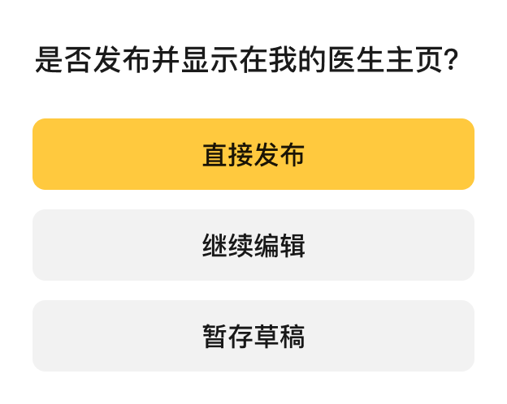

# V2.3.3 鸿蒙文章模块：编辑页产品需求

## 1 基本信息与本轮范围

| 项目 | 内容 |
| --- | --- |
| 需求版本 | V2.3.3 |
| 当前页面 | 文章编辑页，支持新建与按四字段回填已有文章；临时列表入口已移除，本轮接入详情页正式编辑入口 |
| 实施目标端 | HarmonyOS；iOS、Android 本轮仅作现状参考 |
| 文档归属 | sanshi，按实际合作分工持续调整 |
| 文档版本 | v1.6，2026-11-02 |
| 当前阶段 | 新建及已有文章四字段回填已实现；本轮已接入详情编辑入口，23项主机逻辑回归通过；本轮编译受SDK版本不匹配阻塞，真机入口及已有文章后台更新待补验，历史验证见05 |

按页面依次完成需求沟通、实施、验证和提交，再继续其他页面。合作开发的负责内容可以调整；本文件只维护当前编辑页及必要入口、保存返回链路，不代表承接整版或整个文章模块。

本页从已有新建方式弹框的第一个选项“手机上编辑”接入。用户后续确认新增已有文章回填与原ID保存，采用title、content、doctor_article_id、system_article_id四个独立路由字段，不依赖详情页中转。列表卡片点击曾作为测试入口，已在测试结束后按用户要求移除；列表现已恢复详情跳转；本轮补齐详情页编辑入口，显示与分流规则见 REQ-010。列表搜索／删除、电脑编辑、文库、链接转载、文章详情和分享功能仍由各自需求负责。

## 2 需求与设计来源

| 编号 | 来源 | 内容 |
| --- | --- | --- |
| SRC-001 | 2026-10-30 当前会话首次建档 | 需求版本 V2.3.3，harmony article |
| SRC-002 | 2026-10-30 当前会话分析请求 | article 为文章模块；先只读鸿蒙并对照两端；按最新 Figma 整理编辑页，需要富文本方案及键盘上方拍照、相册图标；逐页协作 |
| SRC-003 | 2026-10-30 用户回复 | 采用标题最多 30 字、标题与有效正文非空、图片可算有效正文的建议；保存出现继续编辑／暂存草稿／直接发布三选项，弹窗 UI 后补 |
| SRC-004 | 2026-10-30 用户补充草稿规则 | 暂存草稿调用 article/create_doctor_article，is_send=0；后台成功后提示保存成功，再退出编辑页 |
| SRC-005 | 2026-10-30 用户确认相册数量 | 相册单次最多选择 9 张，与 iOS 对齐 |
| SRC-006 | 2026-10-30 用户调整返回规则 | 返回若未改动直接退出；新建输入内容或已有文章内容修改时增加弹框，按钮为继续编辑／返回；用户进一步确认空白新建直接退出 |
| SRC-007 | 2026-10-30 用户确认粘贴和发布 | 复制粘贴按建议保留文字、换行、段落及常见加粗、链接等基础格式；直接发布沿用两端流程 |
| SRC-008 | 2026-10-30 用户提供并授权导入图标 | 来源目录 /Users/hpt-sans/Downloads/发布图/cer，文件 camera_key.svg、photo_lib_key.svg；已原样导入鸿蒙文章模块资源目录 |
| SRC-009 | 2026-10-30 用户确认退出提示文案 | 使用“当前内容尚未保存，是否返回？”，按钮为继续编辑／返回 |
| SRC-010 | 2026-10-30 用户要求 | 复核需求整理完整性，将技术方案细节补充完整、合理；本轮仍只更新资料 |
| SRC-011 | 2026-10-30 用户补充实施要求 | 页面和组件符合当前效果，合理复用现有组件，注意组件复用 |
| SRC-012 | 2026-10-30 用户授权开发 | 文档先提交，按确认需求和方案开发鸿蒙文章编辑页，复用现有组件，完成编译与验证，不推送 |
| SRC-013 | 2026-10-30 用户补充动态加载规范 | 动态加载页面不再添加 Entry 路由绑定；保留 ComponentV2 和动态 Builder 注册 |
| SRC-014 | 2026-10-30 用户纠正工具栏尺寸 | 键盘上方图标栏设计高度为48；原40需按UI修正，并核对其他间距高度 |
| SRC-015 | 2026-10-30 用户提供精确样式 | 保存48×32、圆角6；标题及占位18／500，正文及占位16／400；正常文字#000000E5、占位#00000042 |
| SRC-016 | 2026-10-30 用户确认已有文章编辑方案 | 四字段传参、原文回填、原ID保存、按初始内容判断改动；列表点击仅作临时测试入口，测试结束后移除 |
| SRC-017 | 2026-11-02 用户要求 | 核对详情右上角编辑显示逻辑，更新本版需求并接入已有编辑页；当前鸿蒙分支 feature/sanshi/article-Q43；消息、待办和协议跳转维持后期范围 |
| DES-001 | [右侧选中 Figma](https://www.figma.com/design/aFKpQlzeW8NibL23OpY5lq/?node-id=21809-6127&p=f)，“手机上编辑”组 | 浏览器只读核对空态、文字输入、长文滚动、图文混排和退出确认框 |
| DES-002 | 2026-10-30 用户提供保存弹框截图，并说明 Figma 中已有该 UI | [保存发布弹框参考图](sources/保存发布弹框-20261030.png)，标题、按钮顺序及主次样式已明确 |

Figma 插件因文件访问权限未能读取，本轮通过右侧浏览器核对可见设计。尚未取得节点级尺寸、颜色和字体标注，不把截图估测写成精确规格。两枚图标现已由用户提供原始 SVG，尺寸以文件为准。保存三选项弹窗现已由用户提供截图补齐，见 DES-002。

## 3 编辑页需求

业务确认状态按来源记录；未在设计稿中展示的异常恢复和系统行为已在技术方案中作工程细化，不把方案说明标记为已运行验证。

| 编号 | 场景与行为 | 确认状态 | 验收关联 |
| --- | --- | --- | --- |
| REQ-001 | 点击已有新建方式弹框的手机上编辑，进入空白文章编辑页 | 已确认，不重做新建方式弹框 | AC-001 |
| REQ-002 | 按最新 Figma 展示白底、返回、编辑文章和黄色保存；标题占位“添加标题”，分隔线下正文占位“请输入正文（您可在其他地方编辑好后一键复制过来）” | UI 方向已确认；效果按最新 Figma，合理复用现有组件，尺寸、颜色与字体通过本页实例配置适配 | AC-002 |
| REQ-003 | 标题最多 30 字、去除空白后非空；正文包含有效文字或图片，只有标签、换行和空白不算有效正文 | 已确认，不采用 HTML 字符串长度阈值；计数与输入法细节由实现处理，见 Q-007 | AC-003 |
| REQ-004 | 正文支持文字、换行、图文混排、光标编辑、删除及复制／剪切／粘贴；中文、英文、数字、标点、表情作为输入基础；粘贴保留文字、换行、段落及常见加粗、链接等基础格式，不增加格式工具栏 | 已确认，Q-006 已关闭 | AC-004 |
| REQ-005 | 正文编辑时，键盘上方提供高度48vp的图标栏，靠左放置拍照和相册两个纯图标按钮；系统拍照／选图后插入正文；相册单次最多选择 9 张，与 iOS 对齐 | 两个按钮、图文能力与单次相册上限已确认；异常恢复已在技术方案细化 | AC-005 |
| REQ-006 | 顶部保存弹框标题为“是否发布并显示在我的医生主页？”，按钮自上而下为直接发布／继续编辑／暂存草稿；继续编辑保留内容，草稿后台成功提示“保存成功”并退出，发布后台成功提示“发布成功”、退出并刷新列表 | 业务与保存弹框 UI 已确认，Q-005 已关闭，见 DES-002 | AC-006、AC-007、AC-009 |
| REQ-007 | 空白新建或已有文章未改动时返回直接退出；新建已输入内容或已有文章内容已修改时返回弹确认框，提示“当前内容尚未保存，是否返回？”，按钮为“继续编辑／返回”。继续编辑关闭弹框并保留内容；返回放弃本次未保存内容并退出，不触发草稿保存 | 返回分支、提示文案及按钮行为均已确认，Q-004 已关闭；替换此前直接退出／保存后退出方案 | AC-008 |
| REQ-008 | 编辑页接收title、content、doctor_article_id、system_article_id四字段；有有效ID时回填标题与正文，草稿／发布携带两个原ID；无有效ID按空白新建处理；普通焦点变化和重新可见不覆盖当前编辑内容 | 已确认，SRC-016 | AC-010 |
| REQ-009 | 列表卡片点击临时直达编辑页并传递四字段，代码及任务均标记article-edit-test-entry；测试结束后移除此点击入口，不作为正式详情或编辑权限规则 | 已确认，SRC-016；测试入口现已移除 | AC-011 |

### 详情页正式编辑入口（2026-11-02）

本轮核对鸿蒙分支 `feature/sanshi/article-Q43`，起点 `0cf08aa3b`：详情已有正文、保存及发送功能，尚无编辑按钮，文章模型未声明 `app_system`。iOS、Android 的现有显示与分流规则一致，按用户本轮接入授权沿用，不以发布状态增加编辑限制；这只是客户端入口规则，不替代后台权限校验。

| 编号 | 场景与行为 | 依据 | 验收关联 |
| --- | --- | --- | --- |
| REQ-010 | 仅 article_source 为字符串1时显示右上角编辑入口；app_system 为 site 时显示“电脑编辑”并进入现有扫码编辑页，携带 doctor_article_id；其余显示“编辑”并进入已有手机编辑页；非1或缺失来源隐藏入口，草稿／发布状态不影响显示 | 两端一致的现有规则及 SRC-017 授权 | AC-012 |
| REQ-011 | 手机编辑传递 title、content、doctor_article_id、system_article_id 四字段，保留两个原ID；草稿或发布后台成功后回传保存内容与状态，详情刷新正文及发送按钮，并通知文章列表刷新；取消或放弃不回传保存结果、不改变详情数据 | 复用 REQ-008、006、007，完成正式入口的数据闭环 | AC-013 |

| 场景 | 右上角显示 | 点击结果 |
| --- | --- | --- |
| article_source=1，app_system=site | 电脑编辑 | 进入已有电脑编辑页，携带医生文章ID |
| article_source=1，其他或缺失 app_system | 编辑 | 进入已有手机编辑页，回填四字段 |
| article_source 非1或缺失 | 不显示 | 不提供编辑入口 |

2026-11-02 用户要求详情右上角编辑按钮沿用编辑页保存按钮样式。实现采用同一黄色主按钮、字号14、圆角6、高32vp；“编辑”宽48vp，“电脑编辑”为容纳四字文案扩为76vp，属于本页布局适配。显示与分流规则保持 REQ-010。

来源：iOS `GCDocArticleViewController.detailArticleWithModel` 的 canEdited／isPCEdit 赋值及 `GCDocArticleDetailViewController.setRightItem/editAriticle`；Android `MyHomePageArticleDetailFragment.initEvent`。两端均只对来源1开放；两端分支和提交记录见本轮技术方案。鸿蒙本次只接正式入口和手机保存返回，不修改电脑扫码协议、详情保存分享规则、消息、待办或协议路由。

### 已确认的草稿流程

1. 用户点击顶部保存，按 REQ-003 检查标题和有效正文。
2. 显示三选项弹框；暂存草稿表示保存到后台服务器。
3. 调用后台接口并使用草稿标记，具体请求见[技术方案](03-编辑页技术方案.md#5-后台保存与数据兼容)。
4. 后台返回成功后提示“保存成功”，再退出编辑页。

直接发布使用同一接口，传 is_send=1，后台成功后提示“发布成功”，退出编辑页并刷新文章列表，已由用户确认。本轮工程细化采用草稿／发布失败留页并保留内容、保存防重复和成功后只退出一次；联调与运行效果尚未验证。上传中或失败图片未处理完不提交文章，避免静默丢图，具体任务状态与恢复见技术方案。

复制粘贴按已确认建议保留文字、换行、段落及常见加粗、链接等基础格式。本页不增加格式工具栏，表格、视频、复杂 Word 排版及直接粘贴图片不纳入本期范围；图片通过已确认的拍照／相册入口插入。

## 4 设计状态与实现细化

| 状态 | Figma 可见内容 | 鸿蒙建议行为 |
| --- | --- | --- |
| 新建空态 | 标题、正文占位，无键盘和图片工具栏 | 进入时不强制拉起键盘，点击后编辑 |
| 标题输入 | 本组未单独提供获焦画面 | 标题自动换行；获焦时隐藏图片工具栏 |
| 正文输入 | 多行标题、正文、键盘；工具栏贴在键盘上方 | 正文编辑且键盘显示时出现工具栏，光标不被遮挡 |
| 长文滚动 | 顶部导航保留，标题滚出画面，正文和工具栏可见 | 标题与正文使用同一滚动内容区，固定原生导航；依据长文稿的交互推断实施并进行视觉核对 |
| 图文混排 | 段落之间有多张图片，无键盘时没有工具栏 | 图片等比适配内容宽度，可在前后继续输入和删除 |
| 返回确认 | 原稿为是否保存此次修改；直接退出、保存后退出 | 已确认：空白新建或已有文章未改动直接退出；新建已输入内容或已有文章内容修改时弹继续编辑／返回；返回不保存，提示文案为“当前内容尚未保存，是否返回？” |
| 顶部保存选择 | 已提供白色圆角弹框，标题为是否发布并显示在我的医生主页；依次为黄色直接发布、灰色继续编辑、灰色暂存草稿 | 按 DES-002 布局和主次样式实现，按钮业务含义保持已确认结果 |
| 上传／保存失败 | 本组未展示 | 提示原因并保留内容；上传中或失败图片未处理完不提交文章，可重试或删除失败图片；按技术方案的工程细化处理 |

键盘使用鸿蒙系统输入法，不复刻设计示例中的系统键盘。拍照与相册图标已由用户提供并原样导入，均为 24×24 SVG、viewBox 为 0 0 24 24；保留原文件名、矢量路径、描边、颜色和透明度。通用返回箭头和按钮优先复用项目组件，实施时核对视觉。

| 用途 | 项目资源 |
| --- | --- |
| 拍照 | [camera_key.svg](../../../hos_doctor/yzs_article/src/main/resources/base/media/camera_key.svg) |
| 相册 | [photo_lib_key.svg](../../../hos_doctor/yzs_article/src/main/resources/base/media/photo_lib_key.svg) |

图标已接入编辑页，沿用原始 24×24 SVG。源目标一致性已检查，设备上两枚图标已观察；代码已本地提交、未推送，提交详情见04。

### 用户确认的编辑区样式

| 区域 | 字号 | 字重 | 颜色 |
| --- | --- | --- | --- |
| 标题占位 | 18 | 500 | #00000042 |
| 标题文字 | 18 | 500 | #000000E5 |
| 正文占位 | 16 | 400 | #00000042 |
| 正文默认文字 | 16 | 400 | #000000E5 |

2026-11-02 用户确认：标题与正文的输入光标颜色直接使用 #A56D5F，在本地编辑器CSS中设置。

顶部保存按钮为48×32vp，圆角6vp。编辑区使用CSS颜色末尾Alpha语义，完整保留用户给定透明度；标题占位显式opacity=1，避免浏览器默认占位透明度再次叠加。正文默认400不覆盖已确认支持的粘贴加粗语义。其他未提供标注的行高、内外间距继续按技术方案标明现值，未一并推定确认。

### 保存弹框 UI

白色圆角面板，上方显示“是否发布并显示在我的医生主页？”。三个圆角按钮纵向排列且文字居中，从上到下依次为黄色“直接发布”、浅灰色“继续编辑”、浅灰色“暂存草稿”。按钮顺序和主次样式以本次截图为准，不照搬旧版两端的排列。参考图已原样归档，尺寸为 624×498 像素，该像素尺寸不直接视作鸿蒙布局单位。

## 5 本页业务验收标准

以下为本页已确认业务目标，异常处理和视觉适配按技术方案细化执行。实现和实际验证覆盖见05，不把主机fake结果扩大为真实发布或完整人工验收通过。

| 验收编号 | 关联需求 | 操作与应成立结果 | 状态 |
| --- | --- | --- | --- |
| AC-001 | REQ-001 | 从已有手机上编辑进入空白编辑页，新建弹框关闭 | 已确认目标 |
| AC-002 | REQ-002 | 空态、输入、长文、图文按最新设计展示，导航可见，工具栏不遮挡编辑 | UI 与合理复用要求已确认；布局、状态及局部适配见技术方案 |
| AC-003 | REQ-003 | 空白标题或超过 30 字不能提交；有效标题配仅空白／换行／空标签的正文不能提交；有效图片可通过正文非空检查 | 已确认目标，超限输入和输入法处理已在技术方案细化 |
| AC-004 | REQ-004 | 基础输入、选择、复制、剪切、粘贴可用；粘贴后文字、换行、段落及常见加粗、链接等基础格式保留，图文顺序在编辑与保存后保持 | 输入与粘贴范围已确认 |
| AC-005 | REQ-005 | 相册单次最多选择 9 张，不能选第 10 张；选图／拍照后图片插入原位置，前后文字保留；取消不增加空图；工具栏高度48vp、跟随正文键盘，图标24×24vp | 必需能力与单次相册上限已确认，异常恢复已在技术方案细化 |
| AC-006 | REQ-006 | 顶部保存显示确认标题和三个纵向按钮，顺序为直接发布／继续编辑／暂存草稿，样式符合 DES-002；继续编辑不保存、不退出且保留内容 | 业务与 UI 已确认 |
| AC-007 | REQ-006 | 暂存草稿确实请求后台，成功提示保存成功后退出，不能只本地保存就提示成功 | 后台草稿流程已确认；失败保留与列表刷新按技术方案细化 |
| AC-008 | REQ-007 | 空白新建或已有文章未改动时直接退出；新建已输入内容或已有文章内容修改时显示“当前内容尚未保存，是否返回？”及继续编辑／返回按钮；继续编辑保留内容，返回放弃未保存内容并退出，全程不因返回发起草稿保存 | 返回分支、提示文案及按钮行为均已确认 |
| AC-009 | REQ-006 | 直接发布请求 article/create_doctor_article，is_send=1；后台成功后提示“发布成功”，退出编辑页并刷新列表 | 用户确认沿用两端流程 |
| AC-010 | REQ-008、007 | 有效ID文章回填标题、正文及合法图片；未改动直接返回，修改后确认，恢复原文后直接返回；草稿／发布保留两个原ID；新建使用两个0，不继承上篇内容 | 已确认，真实后台更新与回读单独验证 |
| AC-011 | REQ-009 | 临时列表入口可直达编辑页；测试完成后移除带article-edit-test-entry标记的点击事件，再接正式详情跳转 | 已确认；临时点击事件和专用传参分支已移除 |
| AC-012 | REQ-010 | 来源1且site显示电脑编辑；来源1且非site显示编辑；其他或缺失来源不显示；草稿和发布均按同一规则 | 本轮按两端一致规则接入 |
| AC-013 | REQ-011 | 手机编辑回填原文并保留两个原ID；保存成功返回详情，正文及发送状态更新，列表收到刷新；取消或放弃不改变详情；加载编辑页失败提示可重试 | 实际验证见05 |

## 6 待确认问题与决定

| 问题编号 | 问题与现状 | 当前决定或建议 |
| --- | --- | --- |
| Q-001 | article 含义与入口 | 已关闭：文章模块，从已有新建弹框的手机上编辑进入 |
| Q-002 | 优先处理页面 | 已关闭：文章编辑页，先只读分析；UI 按最新 Figma，逻辑对照两端后确认 |
| Q-003 | 范围与协作方式 | 已关闭：逐页讨论、实施、验证、提交，分工持续调整；iOS／Android 只读 |
| Q-004 | 返回规则与空白新建边界 | 已关闭：空白新建或已有文章未改动直接退出；新建已输入内容或已有文章内容修改时弹确认框，提示“当前内容尚未保存，是否返回？”，按钮为继续编辑／返回。继续编辑保留内容；返回放弃未保存内容并退出，不保存后台草稿。原保存后退出建议取消；首次仅新建入口；后续经SRC-016确认扩展四字段回填与临时入口，见REQ-008、009 |
| Q-005 | 顶部保存与发布 | 已关闭：顶部保存三选项；草稿 is_send=0，成功提示保存成功后退出；发布 is_send=1，成功提示发布成功、退出并刷新列表。用户已补齐保存弹框 UI，顺序为直接发布／继续编辑／暂存草稿，样式见 DES-002 |
| Q-006 | 相册数量与富格式输入边界 | 已关闭：相册单次最多 9 张，与 iOS 对齐；粘贴保留文字、换行、段落及常见加粗、链接等基础格式，不增加格式工具栏；表格、视频、复杂 Word 排版和直接粘贴图片不纳入本期 |
| Q-007 | 30 字计数与超限表现 | 已完成技术细化，无需用户另行确认：按已确认的 30 字上限处理，采用用户可见字符计数，避免截断表情；输入法组合中不截断，提交再校验，不能只视觉省略却保存超限标题 |

2026-10-30 已确认：标题最多 30 字、标题和有效正文非空、图片可算有效正文；顶部保存三选项及样式已补齐（DES-002）；暂存草稿调用 `article/create_doctor_article`，`is_send=0`，后台成功提示“保存成功”后退出；相册单次最多 9 张，与 iOS 对齐。REQ-003、REQ-005、REQ-006 及相关验收已同步。

2026-10-30 返回规则调整：按钮改为“继续编辑／返回”，返回不自动保存；替代此前“直接退出／保存后退出”的方案建议。用户进一步确认空白新建直接退出，Q-004 关闭；REQ-007、AC-008 及技术方案已同步。

2026-10-30 粘贴与发布确认：采用基础格式粘贴范围，直接发布沿用两端，Q-005、Q-006 关闭；REQ-004、REQ-006、AC-004、AC-009 及技术方案已同步。Q-007 转为实现细节，不新增业务确认。

2026-10-30 保存弹框 UI 补齐：已按用户截图确认标题、按钮顺序及主次样式，DES-002、REQ-006、AC-006 与技术方案同步；退出提示文案随后由用户确认使用“当前内容尚未保存，是否返回？”，按钮保持继续编辑／返回，REQ-007、AC-008 及技术方案同步。本页已提出的业务确认项与所需素材已齐备，后续已获开发授权，当前状态以04、05为准。

## 7 完整性复核与实施边界

2026-10-30 本轮复核覆盖入口、页面状态、输入校验、粘贴、媒体、后台草稿／发布、返回与所需素材；需求与验收对应如下。方案细化属于实现准备，不新增其他文章页面、旧文章入口、远程编辑服务或跨页面本地草稿功能，不把协作分工固定为整版归属。

| 需求 | 验收 | 技术方案定位 |
| --- | --- | --- |
| REQ-001 入口 | AC-001 | 页面路由与依赖、初始化时序 |
| REQ-002 UI | AC-002 | 原生壳、本地编辑区、键盘与保存弹框 |
| REQ-003 校验 | AC-003 | 有效正文、标题字符边界与组合输入 |
| REQ-004 编辑与粘贴 | AC-004 | 粘贴清洗、规范化、最终快照与 HTML 往返 |
| REQ-005 媒体 | AC-005 | 9 张选择、锚点、顺序、上传状态与失败恢复 |
| REQ-006 保存／发布 | AC-006、AC-007、AC-009 | 表单编码、成功码、提交快照、防重复、成功返回 |
| REQ-007 返回 | AC-008 | 空白与修改判断、确认文案、生命周期及迟到回调 |

业务确认项已收口，素材已齐备，无需再补同类确认。用户进一步强调页面效果与组件复用，已在技术方案中明确导航、弹框、按钮、Web 容器的具体复用入口和局部适配方式；复用不能改变最新设计或影响其他页面。当前开发实现和已执行检查见04、05：完整APP、主工程、受影响HSP及25项主机回归通过，设备输入／弹框和测试环境草稿已有验证。真实发布、真实图片上传及全部机型人工验收仍待补，不推定已通过。

## 8 配套资料

- [编辑页现状与三端差异](02-编辑页现状与三端差异.md)：静态事实和源码依据。
- [编辑页技术方案](03-编辑页技术方案.md)：选型、接口、实现与验证安排。

- [本页开发任务与交付](04-开发任务.md)
- [本页AI测试用例与记录](05-AI测试用例与记录.md)

不扩展整版或其他页面的需求与任务。
