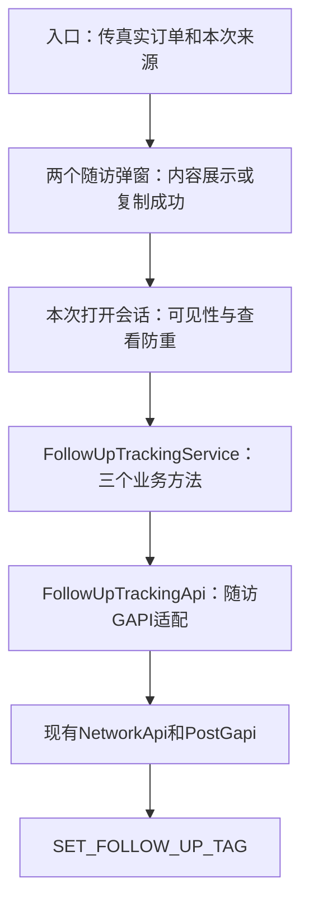

# V5.3.8 sanshi 本迭代技术方案

本方案v2.8对应[产品需求v1.17](01-产品需求.md)。原SAN-REQ-001至008保持；SAN-REQ-009已安装并固定SDK2.9.0、提交公共工具，完整entry／随访／原生分享接线已本地提交67d5cb5d5、未推送。当前只做逻辑和静态检查，运行由用户负责；异常字段策略已按DEC059／060收口，平台元数据及实际运行继续核对，详见[13号方案v1.2](13-鸿蒙GIO接入与随访埋点方案.md)。

第1节及此前实施章节保留历史阶段快照，不作为当前工作区或最新iOS核对结论。鸿蒙当前提交及未执行范围见13号方案第2节，指定iOS对照见06清单第10节。本轮只核对本地源码、配置和差异，没有构建或联调。

2026-10-30当前交付：鸿蒙GIO完整接线已本地提交`67d5cb5d5`（feat: 完成鸿蒙GIO随访埋点接入），包含应用编排、四项业务事件、原生分享回调、集中事件枚举、最新关注分类规则及注释／冗余调用整理；未推送。文档在根仓库独立记录；只做逻辑与静态审查，不编译、不运行测试，设备及平台收数由用户后续验证。

## 1 当前仓库与核对范围

| 端 | 仓库 | 当前分支与 HEAD | 当前工作区 |
| --- | --- | --- | --- |
| Android | `android_doctor/` | 用户创建并切换的 `feature/sanshi/order-preview-Q42`；实施起点 `437c358ac4606286c0b3c760605d182aebe78fbf` | 实施前无改动；本轮仅6个预览专用文件，用户已确认并授权本地提交 |
| 鸿蒙 | `hos_doctor/` | `feature/sanshi/order-0518-Q42`，`8fd3ad334`（2026-10-23随访UI） | 收尾前后代码工作区干净；本次验证未改生产源码 |
| iOS | 不在本次范围 | 未核对 | 不读取或改动业务实现 |

Android 当前实施分支已由用户指定，本文未切换分支。鸿蒙行更新为本次随访UI的提交快照；第3节保留预览实施前的方案依据，当前预览交付以开发任务为准。本次收尾只构建和验证鸿蒙随访UI，未修改生产源码或iOS。Android 编译与2026-10-22的模拟器验证见第2.3节；完整覆盖与缺口见 AI 测试记录。前期鸿蒙 `.codegraph/` 工具与 CLI 不可用，关系查询降级为 `rg` 和源码，未重建索引。

## 2 Android 现状与保留链路

### 2.1 改造前预览数据和生成链路

本节保留实施起点提交的原调用链依据，现行预览代码位置见第2.3节；开方主流程本轮未改动。

1. [PrescribeFragment.kt:1913](/Users/hpt-sans/Desktop/allplatform/android_doctor/app/src/main/java/com/igancao/doctor/ui/prescribe/PrescribeFragment.kt:1913) 的预览按钮设置预览标记，处理输入焦点并执行现有校验和预览请求。
2. [PrescribeFragment.kt:2383](/Users/hpt-sans/Desktop/allplatform/android_doctor/app/src/main/java/com/igancao/doctor/ui/prescribe/PrescribeFragment.kt:2383) 接收预览结果；经 [showAuxiliary() 等确认链](/Users/hpt-sans/Desktop/allplatform/android_doctor/app/src/main/java/com/igancao/doctor/ui/prescribe/PrescribeFragment.kt:4671) 完成适用辅料、胶量及智能审方与签名处理，再在 [next()](/Users/hpt-sans/Desktop/allplatform/android_doctor/app/src/main/java/com/igancao/doctor/ui/prescribe/PrescribeFragment.kt:4570) 将 `previewData`、粉剂类型及特殊拆包标记传给预览页。
3. [PrescribePreviewFragment.kt:100](/Users/hpt-sans/Desktop/allplatform/android_doctor/app/src/main/java/com/igancao/doctor/ui/prescribe/PrescribePreviewFragment.kt:100) 从 `CacheHelper` 读取患者与药方编辑数据，并在337行后绑定 `TransferPreviewData` 中的包装、费用、优惠和药库信息。
4. [PrescribePreviewFragment.kt:82](/Users/hpt-sans/Desktop/allplatform/android_doctor/app/src/main/java/com/igancao/doctor/ui/prescribe/PrescribePreviewFragment.kt:82) 通过 `PREVIEW_CALLBACK` 回到开方流程；[PrescribeFragment.kt:2056](/Users/hpt-sans/Desktop/allplatform/android_doctor/app/src/main/java/com/igancao/doctor/ui/prescribe/PrescribeFragment.kt:2056) 继续患者信息及生成相关处理。预览页不是独立发送接口。
5. 生成按钮不立即退出预览。需要修改患者信息时，[showEditPatientDialog()](/Users/hpt-sans/Desktop/allplatform/android_doctor/app/src/main/java/com/igancao/doctor/ui/prescribe/PrescribeFragment.kt:6592) 关闭预览并进入编辑；生成成功后，[原成功分支](/Users/hpt-sans/Desktop/allplatform/android_doctor/app/src/main/java/com/igancao/doctor/ui/prescribe/PrescribeFragment.kt:2875) 发送移除预览事件，再进入完成页或返回咨询。

[PrescribePreviewFragment.kt:63](/Users/hpt-sans/Desktop/allplatform/android_doctor/app/src/main/java/com/igancao/doctor/ui/prescribe/PrescribePreviewFragment.kt:63) 明确处理费用明细隐藏配置、隐藏保险行和受限医助按钮文案。这些现状用于识别迁移点；本次已确认将保险隐藏调整为按订单详情固定展示，费用隐藏配置与医助规则继续保留。

编号与保险的现状核对及最终处理如下：

- [ApiService.kt:1038](/Users/hpt-sans/Desktop/allplatform/android_doctor/app/src/main/java/com/igancao/doctor/api/ApiService.kt:1038) 的 `acrecipel/preview` 返回 `TransferPreview`，[TransferPreviewData](/Users/hpt-sans/Desktop/allplatform/android_doctor/app/src/main/java/com/igancao/doctor/bean/TransferPreview.kt:14) 未声明本次订单的 `pay_orderid`；开方成功响应才在 [TransferOneData](/Users/hpt-sans/Desktop/allplatform/android_doctor/app/src/main/java/com/igancao/doctor/bean/ChatType.kt:168) 中读取该字段。按用户最终确认，预览隐藏编号行及复制入口，不加字段、不查询或申请编号。
- Android 订单详情使用固定保险文案，点击打开现有 `Const.INSURANCE` 条款地址，见 [NormalDetailV2Fragment.kt:342](/Users/hpt-sans/Desktop/allplatform/android_doctor/app/src/main/java/com/igancao/doctor/ui/record/recorddetail/NormalDetailV2Fragment.kt:342)。预览按本次确认移除旧隐藏处理，复用保险布局、文案与跳转，不新增投保状态判断或后台请求。

### 2.2 订单详情复用候选

| 展示部分 | 已有能力 | 预览适配要点 |
| --- | --- | --- |
| 页面结构和背景 | [fragment_normal_detail_v2.xml](/Users/hpt-sans/Desktop/allplatform/android_doctor/app/src/main/res/layout/fragment_normal_detail_v2.xml:389) | 取适用视觉结构，不复制订单状态头和订单操作区 |
| 患者信息 | [layout_order_detail_v2.xml](/Users/hpt-sans/Desktop/allplatform/android_doctor/app/src/main/res/layout/layout_order_detail_v2.xml:1) | 当前开方字段重新绑定；隐藏编号行和复制入口，不借用来源订单号；订单专属入口按预览实际需要裁剪 |
| 药方信息 | [layout_recipe_detail_v2.xml](/Users/hpt-sans/Desktop/allplatform/android_doctor/app/src/main/res/layout/layout_recipe_detail_v2.xml:1) | 保留预览中各剂型、协定方、新标切换、包装、医嘱等分支 |
| 诊后设置和保险 | [layout_recipe_insurance_v2.xml](/Users/hpt-sans/Desktop/allplatform/android_doctor/app/src/main/res/layout/layout_recipe_insurance_v2.xml:1) | 配置来自当前开方；保险按订单详情固定文案、样式和条款链接展示，不引入开方、付款时间或新增状态接口 |
| 费用明细 | [layout_order_price_detail_v2.xml](/Users/hpt-sans/Desktop/allplatform/android_doctor/app/src/main/res/layout/layout_order_price_detail_v2.xml:1) | 绑定 `TransferPreviewData`，保留优惠、合计、隐藏明细配置和展开收起 |
| 绑定方式参考 | [NormalDetailV2Fragment.kt:427](/Users/hpt-sans/Desktop/allplatform/android_doctor/app/src/main/java/com/igancao/doctor/ui/record/recorddetail/NormalDetailV2Fragment.kt:427) | 借鉴展示映射，不复制订单查询、操作解析和角色状态判断到预览 |

建议继续沿用 XML、ViewBinding 与原预览 Fragment，通过共享 include 或复制必要布局完成新 UI。按原绑定逐项迁移到新控件，避免只完成视觉而遗漏低频剂型或条件内容。对共享布局的修改同时检查真实订单详情，避免预览适配影响详情展示。

### 2.3 Android 本轮实现与验证记录

2026-10-21，在用户现有分支上改造原预览页，没有新增页面入口。现有四块 V2 卡片、字体、头图、保险和成药条目资源直接复用，顶部固定“预览处方”，正文滚动、底部单一生成操作。编号整行及订单专属入口、开方和付款时间仅在预览实例中隐藏，共享 XML 与订单详情代码均未修改。

| 位置 | 本轮职责与保留边界 |
| --- | --- |
| [PrescribePreviewFragment](/Users/hpt-sans/Desktop/allplatform/android_doctor/app/src/main/java/com/igancao/doctor/ui/prescribe/PrescribePreviewFragment.kt:127) | 保留原 `newInstance()`、缓存与预览响应来源；分区域绑定、处理原有交互和生成事件，不新增请求或直接提交 |
| [PrescribePreviewUiMapper](/Users/hpt-sans/Desktop/allplatform/android_doctor/app/src/main/java/com/igancao/doctor/ui/prescribe/preview/PrescribePreviewUiMapper.kt:20) 与 [UiModel](/Users/hpt-sans/Desktop/allplatform/android_doctor/app/src/main/java/com/igancao/doctor/ui/prescribe/preview/PrescribePreviewUiModel.kt:9) | 接收原数据，整理患者、药方、诊后设置与费用展示；保留剂型、内外用、包装、医助和明细隐藏条件，不回写缓存、不计算整方价格 |
| [MedicineCtmAdapter](/Users/hpt-sans/Desktop/allplatform/android_doctor/app/src/main/java/com/igancao/doctor/ui/prescribe/MedicineCtmAdapter.kt:13) | 当前仅预览使用，改用已有 V2 成药条目；保留价格为空时不展示金额，重置复用条目状态。共用 `MedicineGridAdapter` 未修改，预览仍传 `onPrescribe = true` |
| [预览页面布局](/Users/hpt-sans/Desktop/allplatform/android_doctor/app/src/main/res/layout/fragment_prescribe_preview.xml:1) 与 [费用行](/Users/hpt-sans/Desktop/allplatform/android_doctor/app/src/main/res/layout/item_prescribe_preview_price_row.xml:1) | 复用详情 V2 卡片和费用条目；预览专用行保留 `pay_info_list.line` 分隔条件，合计避免重复货币符号，保险沿用现有条款跳转 |

已使用项目本地 JDK 17 执行 `./gradlew --offline :app:compileDebugKotlin --console=plain`，最后一次编译成功，包含资源与 ViewBinding 生成。静态检查确认入口参数、3000ms 生成按钮回调、成功关闭预览事件保留，原剂型分支与费用字段未遗漏，共享卡片布局、订单详情、接口及开方主流程无代码差异，新增展示数据类均有 `@Keep`。

Figma 插件仍因编辑权限不足无法返回设计数据，按用户允许的浏览器路径放大核对可见预览画板并复用现有资源；没有更改设计文件。

2026-10-22，用户授权 ADB + UIAutomator 后，使用当前工作区 `:app:assembleDebug` 成功构建并覆盖安装到已运行的模拟器，保留应用数据。完成46项页面检查：45项通过，图片左右滑动1项自动检查未通过，随后用户手动确认正常并关闭；另4项原入口与回调源码核对通过。患者数据、长文本、新标药材切换、费用展开、保险及药库跳转、返回编辑重开、修改剂数后金额刷新，以及真实订单详情的编号、档案、时间、保险和费用均已核对。草稿已恢复7剂、155元服务费、505.53元合计及7天随访。图片滑动的自动手势在本构建的未修改订单详情中也停留1/2；用户后续反馈手动滑动正常，人工结论与原自动化结果分别保留。

详细环境、证据、失败重跑和未覆盖范围见[AI测试记录](04-AI测试用例.md)。实际生成发送、失败取消、医助角色、金额隐藏账号配置及其他剂型尚未运行验证，真机验收未执行；原回调源码一致不替代提交实测。测试轮未修改 Android 源码。用户已确认开发内容并授权提交；提交前 IDE 格式化后6个文件与已测试版本的校验值一致，本次不重建、不重复页面测试，不推送。

## 3 鸿蒙预览处方

### 3.1 当前入口和生成链路

[MakePrescribeDistributionAndPreviewInfo.ets:101](/Users/hpt-sans/Desktop/allplatform/hos_doctor/yzs_recipel/src/main/ets/make_prescribe/components/MakePrescribeDistributionAndPreviewInfo.ets:101) 中预览按钮被注释；当前生成按钮在112行按医助权限选择文案，121行调用 `clickGenerateRecipeAndSendAction`。

[DeliverAddress.ets:203](/Users/hpt-sans/Desktop/allplatform/hos_doctor/yzs_recipel/src/main/ets/make_prescribe/view_model/DeliverAddress.ets:203) 先做 `verificationMessage(true)`，再进入药材预览与原有确认处理；237行的 `generateRecipeRequest` 使用当前开方数据组装预览请求，249行调用 `recipePreview`。其返回处理会继续进入生成检查，不能将这个完成回调原样当作“只看预览”的流程。

可用数据来自 `TreatmentServicesManager` 下的患者、药方、配送和服务费等当前状态，以及 `acrecipel/preview` 的计算结果。请求组装入口为 [TreatmentServicesManager.ets:913](/Users/hpt-sans/Desktop/allplatform/hos_doctor/yzs_recipel/src/main/ets/make_prescribe/manager/TreatmentServicesManager.ets:913)，费用预览及乱序保护见 [ServiceFee.ets:76](/Users/hpt-sans/Desktop/allplatform/hos_doctor/yzs_recipel/src/main/ets/make_prescribe/view_model/ServiceFee.ets:76)。字段来源已静态核对，见第3.3节；展示模型及实际绑定尚未实现，不能表述为运行验证。

### 3.2 复用订单详情的边界

[MakePrescribeDetail.ets:150](/Users/hpt-sans/Desktop/allplatform/hos_doctor/yzs_order/src/main/ets/pages/MakePrescribeDetail.ets:150) 的主体由状态区、诊后摘要、地址、患者、药方、诊后设置、账单及底部订单操作组成。实际订单数据由 [MakePrescribeDetailViewModel.requestDrugInfo:948](/Users/hpt-sans/Desktop/allplatform/hos_doctor/yzs_order/src/main/ets/view_models/MakePrescribeDetail.ets:948) 查询 `acrecipel/getone` 后解析，预览不能依赖这个生命周期。

| 复用候选 | 当前形态 | 预览需要调整 |
| --- | --- | --- |
| [PrescriptionInformation](/Users/hpt-sans/Desktop/allplatform/hos_doctor/yzs_order/src/main/ets/components/PrescriptionInformation.ets:5) | 独立 `@ComponentV2`，接收药材、药库、提示行和中成药模型 | 由当前开方映射数据，不依赖订单状态；药库介绍等回调使用预览上下文 |
| 患者信息 | 详情页内 `patientInfo()`，非独立导出组件 | 提取为订单模块内可复用展示，预览隐藏编号及复制入口，真实订单详情仍展示自己的 `recipel.pay_orderid` |
| 诊后设置与保险 | 详情页内 `tipInfo()` 等方法，包含开方与支付时间、固定保险区域 | 共用适用配置和固定保险展示、条款跳转；预览不引入尚未发生的开方或支付时间 |
| 账单与明细 | 详情页内 `totalBillInfo()` 等方法 | 按当前设计及鸿蒙订单详情展示，绑定本次预览合计与明细；不额外引入 Android 的隐藏金额明细配置判断，不用订单支付结果组装 |
| 顶部和底部 | 标题、状态、操作列表均依赖订单状态 | 新页固定预览标题、单一生成操作，单独处理角色文案 |

用户已确认在 `yzs_order` 内新增独立预览页，复用订单模块内组件，不再把展示组件整体下沉至 `biz_*` 作为本次候选方案。`yzs_recipel` 通过公共动态路由进入，不直接导入订单模块实现；订单预览页也不直接依赖开方模块的 `TreatmentServicesManager`。

该方案已有动态路由能力作为依据：[OrderDynamicRouteWiring.ets:16](/Users/hpt-sans/Desktop/allplatform/hos_doctor/yzs_order/src/main/ets/router/DynamicRouteWiring.ets:16) 注册订单页面加载器，入口在启动时接线；开方模块在 [MakePrescribePatientInfo.ets:385](/Users/hpt-sans/Desktop/allplatform/hos_doctor/yzs_recipel/src/main/ets/make_prescribe/components/MakePrescribePatientInfo.ets:385) 已通过该方式打开订单模块的完整反馈页。[DynamicPageRegistry.ets:43](/Users/hpt-sans/Desktop/allplatform/hos_doctor/hpt_scaffold/src/main/ets/router/DynamicPageRegistry.ets:43) 支持参数传入和页面退出后的结果回调。本次需注册新的预览页面路由，生成动作回调与退出时的 `onPop` 分开处理，见第3.4节；不能直接套用只按订单号读取详情的现有入口。

鸿蒙详情中的药方编号取自 [MakePrescribeDetailViewModel.ets:694](/Users/hpt-sans/Desktop/allplatform/hos_doctor/yzs_order/src/main/ets/view_models/MakePrescribeDetail.ets:694) 的 `recipel.pay_orderid`；该真实订单字段不进入生成前预览。保险由 [MakePrescribeDetail.ets:632](/Users/hpt-sans/Desktop/allplatform/hos_doctor/yzs_order/src/main/ets/pages/MakePrescribeDetail.ets:632) 的本地资源固定展示，条款跳转见 [MakePrescribeDetailViewModel.ets:1448](/Users/hpt-sans/Desktop/allplatform/hos_doctor/yzs_order/src/main/ets/view_models/MakePrescribeDetail.ets:1448)。按用户确认直接复用这套保险展示，不新增字段或接口。

### 3.3 数据映射与展示适配

开方模块根据本次开方的有效编辑状态及匹配的预览结果组装展示数据，通过公共动态路由传给订单模块预览页。数据覆盖患者、附件、药库、药材、剂型与服用信息、诊后设置、费用和优惠；预览不需要编号字段，保险采用订单模块现有本地资源与条款跳转。不构造假订单来触发订单状态解析。

| 展示内容 | 鸿蒙当前来源 | 映射与复用要求 |
| --- | --- | --- |
| 患者基本信息、主诉与诊断 | `patientViewModel.patientModel` | 使用当前患者与编辑值，微信开方占位手机号按 Android 预览规则隐藏 |
| 现病史、刻下症 | `current_symptoms`、`present_illness_history` | 按实际业务含义映射：前者为现病史、后者为刻下症；不按英文标识直译。提交分别对应 `disease_course`、`clinical_manifestations` |
| 病历附件 | `patientModel.photo` | 用图片地址展示及查看大图，`photo_ids` 仅为提交标识；保留现有图片地址解析 |
| 药库、剂型、药库介绍 | `recipelInfoModel.storage` | 使用当前药库名称、图标、剂型和介绍参数，不从旧订单补数据 |
| 药材、剂量、新标与加工备注 | `recipelInfoModel.content` | 详情的剂量映射默认取 `q`，预览需按当前开方授权选择 `k/q`，沿用 `q` 空时的现有换算兜底，不从精简提交 JSON 反构完整展示 |
| 中西成药 | `patentMedicineContent` | 映射成药名称、规格、厂商、数量、单价及备注；原逻辑会清空转出后的 `content`，不能只读取普通药材列表 |
| 协定方 | `contractInfo.prescriptId/title` | 数据已有，`PrescriptionInformation` 尚无协定方名称参数，需适配展示，不新增后台依赖 |
| 剂数、服用方式、包装、出膏包数、备注及医嘱 | 当前药方模型、`auxiliaryData` 及本次响应 `packing_type` | 按当前剂型与内外用分支构造展示行；编号和订单状态不参与映射 |
| 诊后随访与咨询 | `recipeOtherInfoModel` 中的有效开关、天数 | 使用当前开方配置，不带入详情中的已发送时间或结果状态 |
| 合计、费用与优惠明细 | 本次响应 `money/pay_info_list/notes_deduction_list` | 一起绑定本次有效响应，费用和包装不得混用上一次自动试算结果；保留明细字段及适用格式 |

上述来源分别见[患者参数组装](/Users/hpt-sans/Desktop/allplatform/hos_doctor/yzs_recipel/src/main/ets/make_prescribe/view_model/DeliverAddress.ets:843)、[药方模型](/Users/hpt-sans/Desktop/allplatform/hos_doctor/yzs_recipel/src/main/ets/make_prescribe/model/RecipelInfoModel.ets:15)、[开方药材剂量展示](/Users/hpt-sans/Desktop/allplatform/hos_doctor/yzs_recipel/src/main/ets/make_prescribe/components/MedicineInfor.ets:393)和[费用响应处理](/Users/hpt-sans/Desktop/allplatform/hos_doctor/yzs_recipel/src/main/ets/make_prescribe/view_model/ServiceFee.ets:145)。当前生成预览链主要处理风险与提交，费用由另一条自动试算链更新；新增预览必须把本次响应整理为一致的页面数据，再进入订单模块。

订单详情使用的 `usage_combine`、`outerpack_tip`、`coating_title` 在当前预览路径尚未建立对应来源，Android 现有预览也不依赖这几项。展示适配先使用已有本地服法、包衣选项和预览包装结果，不推定后台会返回详情专属文案，不据此增加后台字段要求。

返回编辑后重新构造预览；已有草稿恢复和预览请求乱序保护不得被绕开。复用时按需把患者、诊后设置与保险、账单等页内构建方法提取为订单模块内的共用组件，保留真实订单详情的编号、状态和操作行为。

### 3.4 已确认的生成回调与导航时序

1. 开方模块完成现有必要校验并取得匹配当前编辑状态的预览结果；风险提示与签名对齐 Android，在进入页面前处理适用的辅料、胶量、智能审方及签名确认。处理完后进入展示分支，不继续落单。
2. 订单模块预览页只负责展示与交互，固定标题、隐藏编号、显示固定保险与一个按角色显示的生成按钮；合计与明细按当前设计及鸿蒙订单详情处理，不额外引入 Android 的隐藏配置判断。
3. 点击生成，通过本次页面的动作回调交回开方模块，保留预览；普通返回与生成动作分别处理。现有动态路由 `onPop` 在页面退出后才执行，不能仅用它承接生成而变成先退出预览，也不让订单模块依赖开方模块内部管理类。
4. 开方模块继续原有患者资料、颗粒剂授权、屏蔽及提交检查，保留医助分流；不重复同一次已经确认的风险内容。取消确认或提交失败时按 Android 保留预览，需要修改时返回编辑。
5. 生成成功后先清理预览，再由原开方流程完成成功页或咨询返回，并保留原有草稿清理。当前 [prescribeSuccessful()](/Users/hpt-sans/Desktop/allplatform/hos_doctor/yzs_recipel/src/main/ets/make_prescribe/view_model/DeliverAddress.ets:666) 按开方入口和路由模式执行 `replace/pop`；新增预览后不能原样操作栈顶，否则可能只替换或退出预览。具体回调签名和栈操作在实施时按现有导航能力衔接，业务时序已确认。

### 3.5 SAN-NOTE-001：预览请求参数的开发阶段备注

对照 [Android 预览接口](/Users/hpt-sans/Desktop/allplatform/android_doctor/app/src/main/java/com/igancao/doctor/api/ApiService.kt:1038)与[鸿蒙预览参数模型](/Users/hpt-sans/Desktop/allplatform/hos_doctor/yzs_recipel/src/main/ets/make_prescribe/model/RequestPreviewParams.ets:30)，存在以下传参差异。静态源码不能证明这些差异对后台计算的实际影响。

| 参数 | 当前差异 | 开发时需确认的内容 |
| --- | --- | --- |
| `usage_time` | Android 传入服用时间，鸿蒙当前预览参数未传；鸿蒙本地已有该值 | 当前剂型的预览计算是否依赖，以及是否需要补传 |
| `is_special_writing` | Android 显式传入，鸿蒙当前预览仅处理有效的 `num_per_pack`，未传该标记 | 是否需要与每剂出包数一起传入，以及启用条件 |
| `auxiliaryNotify` | Android 有膏方辅料提示相关传参与本地状态，鸿蒙当前预览未发现对应处理 | 后台当前是否仍使用该参数，鸿蒙是否需要及如何接入 |

用户已明确以上差异先备注，不阻塞当前预览方案确认。开发涉及对应参数时再找用户确认，依据确认结果更新参数处理与本方案；不自动按 Android 补传，也不把三项统一列为开工前必须解决的后台依赖。

## 4 鸿蒙消息与待办跳转（最终确认）

### 4.1 实施起点源码依据

2026-10-26静态核对鸿蒙分支`feature/sanshi/order-0518-Q42`、HEAD `fc2e6cf99`，已有`AppScope/app.json5`未提交改动，本轮未触碰。第1节及原运行记录仍是历史快照。本轮仅文档整理，未构建或执行测试；索引CLI不可用，按rg及源码核对。

- Push的`PushPayloadParser`、`PushPayload`和`BusinessHandler`显式维护字段；`MessageNavigator.ets:127`的RECIPEL分支当前只传订单号，后续需按实际消息结构接收并透传open_reply。
- 待办列表[ToDoStateViewModel.ets:116](/Users/hpt-sans/Desktop/allplatform/hos_doctor/yzs_notice/src/main/ets/view_models/ToDoStateViewModel.ets:116)与首页[Home.ets:358](/Users/hpt-sans/Desktop/allplatform/hos_doctor/entry/src/main/ets/view_models/Home.ets:358)共用`todoItemJump`。
- [ToDoJumpProtocol.ets:23](/Users/hpt-sans/Desktop/allplatform/hos_doctor/biz_middle_extension/src/main/ets/utils/ToDoJumpProtocol.ets:23)支持?in=和#编码JSON，191行将prescribe/feedback归一化为订单详情路由；[BridgeNavService.ets:683](/Users/hpt-sans/Desktop/allplatform/hos_doctor/biz_middle_extension/src/main/ets/utils/NavigationService/BridgeNavService.ets:683)目前仅取订单号。
- `OrderDetailRouterParam`及`OrderNavigator.toOrderDetail()`需透传本次进入详情后的内部动作意图；这属于客户端内部路由参数，不是要求后台新增待办参数。
- [MakePrescribeDetail.ets:226](/Users/hpt-sans/Desktop/allplatform/hos_doctor/yzs_order/src/main/ets/view_models/MakePrescribeDetail.ets:226)已有详情加载成功后处理其他弹层的时序；[openCompleteFeedback():447](/Users/hpt-sans/Desktop/allplatform/hos_doctor/yzs_order/src/main/ets/view_models/MakePrescribeDetail.ets:447)为当前查看反馈业务方法。

### 4.2 消息与待办入口的触发条件

| 入口 | 生成查看反馈意图的条件 | 后续动作 |
| --- | --- | --- |
| 消息中心及系统推送的RECIPEL | open_reply为数字1或字符串1 | 先订单详情，加载成功后调用现有openCompleteFeedback()，分别保留message和systemNotification内部来源 |
| 待办igancao://prescribe/feedback | 命中该待办协议即成立，不读取额外开关 | 使用已有订单号先进入详情，加载成功后调用同一方法 |
| 其他消息或待办协议 | 按各自原规则 | 不因共用订单详情路由自动附带本次动作 |

待办沿用原btn_jmp及订单号，取消新增open_reply和显式反馈标识的方案。已按用户确认在待办协议匹配到prescribe/feedback的专属分支后补充内部动作参数，再执行订单号等通用别名归一并沿公共导航传递；避免只在共用订单详情路由上无条件开启，影响其他普通订单入口。保留原协议编码、别名及末尾斜杠兼容，首页与待办列表同样适用。

### 4.3 订单详情统一执行

详情请求成功并完成当前订单数据绑定后，消费本次内部动作意图并调用现有`openCompleteFeedback()`。复用当前查看反馈按钮的业务方法，不模拟控件点击，不复制一套反馈上下文组装或状态分流逻辑；详情缺少反馈流水号等情况沿用方法原校验与提示，保留详情。订单号缺失、协议解析失败、详情请求失败分别保留原异常处理。

自动调用以同一次入口点击为单位，只执行一次。关闭反馈、返回详情、刷新和页面重新出现不重复拉起；异步返回时确认页面仍有效且订单未切换，避免误开其他订单反馈。不直接使用按诊后状态分流的`openTipDialog`代替本次固定查看反馈意图。

消息中心保留消息来源，Push保留系统通知来源，待办保留待办来源；待办点击标记、完成、列表更新及消息已读处理不变。MessageModel接收列表响应顶层或extras.open_reply，非空顶层优先，缺失/null/空串时取extras；仅数字1或字符串1归一为true。共用RECIPEL分发不再限制Push来源，FOLLOW_UP独立逻辑保留。新埋点API继续后置，不作为导航前置依赖。完整确认记录见[消息与待办跳转协议](07-消息与待办跳转协议.md)。

## 5 鸿蒙后台埋点

### 5.1 现有封装与复用边界

目前已有 [AIBehaviorTrackingService.ets](/Users/hpt-sans/Desktop/allplatform/hos_doctor/biz_ai/src/main/ets/tracking/AIBehaviorTrackingService.ets:1) 与 [AIBehaviorTrackingApi.ets](/Users/hpt-sans/Desktop/allplatform/hos_doctor/biz_ai/src/main/ets/tracking/AIBehaviorTrackingApi.ets:1)，经网络层调用历史 GAPI `SET_AI_SUMMNARY_TAG`，参数为历史 AI 行为模型。它们证明当前具备后台上报模式，不证明该 API 和字段适用于 AI 随访。

2026-10-27已收到后台#666，新增GAPI为igc_crm.recipel.client／SET_FOLLOW_UP_TAG，不调用历史AI诊疗GAPI占位。完整协议及差异见第5.9节和10号对照文档：三项医生直报已列明，分享归后台、消息与系统推送统一Push、字段责任已确认，部署与幂等说明待补。工具和页面接入已完成，最新咨询入口规则见第5.20至5.21节；真实设备与后台联调未执行。

现有 Service 在请求前记录 `event/orderid/serial/from_source` 去重键，不检查后台业务响应，异常也不释放该键；不能直接将这套实例内策略用于随访。已确认的统计规则是每次打开成功展示记一次、重新打开重新计、复制逐次成功操作记，分享发起由后台记录；请求重试如何不重复计数等传输细节待新协议补充。现有 AI 诊疗事件和调用口径不随本需求改变。

公共上报核心与业务方法分层已落实为随访专用封装、页面会话及实际接线，第5.10至5.21节说明设计和最终规则；本期复用公共网络层，不扩建全APP通用平台。原文编号只作追踪，不直接作为后台事件名或参数。

### 5.2 三项APP上报与后台分享的接入位置

| 追踪编号 | APP 页面 | 当前代码位置 | 拟接入的业务节点与待确认边界 |
| --- | --- | --- | --- |
| E01／followup_plan_view | 随访计划弹窗 | [列表入口](/Users/hpt-sans/Desktop/allplatform/hos_doctor/yzs_order/src/main/ets/components/DoctorOrderListCard.ets:719)、[详情入口](/Users/hpt-sans/Desktop/allplatform/hos_doctor/yzs_order/src/main/ets/view_models/MakePrescribeDetail.ets:424)均进入FollowUpPlanDialog；FollowUpPlanViewModel.load()映射成功后由页面展示 | 两入口传开方记录／开方详情来源，弹窗内成功展示后按新接口上报orderid／event／event_tag，reply_status推荐由后台回填 |
| E02后台分享发起 | 现有微信分享及版本同步 | FollowUpPlanDialog.shareToWeChat先同步版本，再调用微信分享 | 用户已确认后台switch_invest_version记录发起；APP不新增分享埋点、不为统计改微信回调，原功能保持 |
| E05/E06 合并 | 完整反馈半屏页 | [CompleteFeedbackViewModel.load()](/Users/hpt-sans/Desktop/allplatform/hos_doctor/yzs_order/src/main/ets/complete_feedback/CompleteFeedbackViewModel.ets:57) 映射内容并切换成功状态；[CompleteFeedbackDialog.ets:104](/Users/hpt-sans/Desktop/allplatform/hos_doctor/yzs_order/src/main/ets/complete_feedback/CompleteFeedbackDialog.ets:104) 展示内容 | 只在最终反馈具体页的正文或小结成功展示时记录本次查看及来源；同次打开一次、重开重计，途中入口和订单详情不另计 |
| E07／followup_summary_copy | 完整反馈三个复制区域 | CompleteFeedbackDialog的小结复制、copyTongueIcon()、copyAllIcon()／copyAnswers()统一调用copy()，小结入口已由`8fd3ad334`新增 | UI及剪贴板成功节点已具备；后续新API到位后三处统一上报orderid和event，不新增区域类型字段 |

分享已由用户确认按后台#666发起口径处理，APP取消直报，不再为统计改造ShareUtil的成功返回链。当前源码仍先同步版本再调用微信分享，现有功能保持；后台记录不代表微信发送或送达。此前方案要求透传微信成功结果的工作已取消，原源码差异仅作分析依据。

2026-10-23的 [copy()](/Users/hpt-sans/Desktop/allplatform/hos_doctor/yzs_order/src/main/ets/complete_feedback/CompleteFeedbackDialog.ets:569) 已等待剪贴板写入成功，再提示“复制成功”；异常提示“复制失败，请重试”。小结复制使用当前summary正文，舌象复制保留tongue_change_conclusion正文，问卷复制保留answerCopyText。三处成功节点已接入上报，只上传orderid和event，account_type=1由后台写；相同内容的主动重复复制逐次计数。

### 5.3 合并后的反馈查看与来源透传

用户已确认原 E05、E06 合并为一个“医生实际查看反馈，并携带来源”的行为。来源沿本次进入链路传至最终反馈页；系统通知、消息、待办或咨询引导的多段跳转保留相应来源，无引导来源的自主打开分别按开方页、开方记录、开方详情记录。只在最终页本次成功展示记一次，不在入口或中间页面分别记录。业务逻辑已明确，本轮API字段与六个来源值已提供；消息中心和系统推送在埋点请求层均映射为Push，七类入口归为六类上报来源。

| 业务来源 | APP 入口与当前处理位置 | 后续处理范围 |
| --- | --- | --- |
| 系统通知 | 系统 Push 点击，[UnifiedPushEntry.handle()](/Users/hpt-sans/Desktop/allplatform/hos_doctor/entry/src/main/ets/push/UnifiedPushEntry.ets:51) 及后续分发 | 核对冷启动恢复和重复消费，再按有效来源透传；通知接收不作为反馈查看 |
| 消息 | 消息中心条目，[MessageViewModel.readMessage()](/Users/hpt-sans/Desktop/allplatform/hos_doctor/entry/src/main/ets/package_home/message/view_models/Message.ets:46)，后续交给消息导航 | 来源延续至完整反馈页；保留已读和跳转处理，不另报通知点击 |
| 待办 | 首页 [Home.ets:436](/Users/hpt-sans/Desktop/allplatform/hos_doctor/entry/src/main/ets/pages/Home.ets:436)、待办助手 [ToDoItemView.ets:91](/Users/hpt-sans/Desktop/allplatform/hos_doctor/yzs_notice/src/main/ets/components/ToDoItemView.ets:91) | prescribe/feedback经订单详情调用查看反馈时保留待办来源；不新增后台控制字段，埋点接入仍等待新API |
| 开方页 | MakePrescribePatientInfo的随访摘要进入完整反馈链路 | 直接手动打开时传开方页来源 |
| 开方记录 | DoctorOrderListCard.openCompleteFeedback() | 列表直接手动打开时传开方记录；先进入详情再手动打开则按开方详情 |
| 开方详情 | MakePrescribeDetailViewModel.openCompleteFeedback() | 手动打开时传开方详情；若属于通知、消息、待办、咨询引导链路则保留引导来源 |
| 咨询 | 咨询会话的反馈相关卡片，[ChatP2PViewModel.cardPush()](/Users/hpt-sans/Desktop/allplatform/hos_doctor/yzs_chat/src/main/ets/view_models/ChatP2PViewModel.ets:1366) | 按已确认卡片类型透传咨询来源，不能将普通问诊单或其他卡片统一算作反馈查看 |

E05/E06 合并项的来源可能经过入口、公共路由、订单详情和完整反馈页面，后置实现时逐层透传，避免中间跳转丢失。来源上下文限本次进入链路使用，新的独立手动打开不能继承旧通知来源。当前只记录逻辑，不编写具体字段和枚举（本轮已有映射的来源见06清单，消息中心同为Push）。

### 5.4 新 API、统计频次与后置安排

随访计划和完整反馈当前共用 [getFollowUpPlan()](/Users/hpt-sans/Desktop/allplatform/hos_doctor/yzs_order/src/main/ets/api/MakePrescribeDetail.ets:22) 调用 `invest/show_reply_detail`。该接口及其已读注释不替代本次新增上报 API。后台内部如何复用存量记录由其处理，客户端不据旧接口调用自行省略已确认行为。

查看事件以本次打开的展示周期为单位：成功展示一次后，同周期刷新、重建不重复；关闭后重新打开并成功展示再记一次。三个区域的复制按每次真实成功操作记录；分享由后台记录发起，同一次操作的重复回调不重复计数。业务频次已确认；事件标识及字段按新协议整理，幂等和失败补报尚未提供，业务层不主动重试或建离线队列；网络层与旧AI埋点一致，沿用默认行为。

后台11类事件分工、当前三项APP请求及旧15参数逐项处理见[APP埋点清单](06-APP埋点清单.md)和10号对照文档。患者端不纳入本清单。SAN-DEV-HOS-005至009尚未编码或联调；2026-10-27API已提供，当前先补协议对照，分享归后台、消息中心与系统推送统一Push已确认，来源枚举已收口，接口样例及幂等约定仍待补。本轮不新增 API 调用、埋点事件、缓存队列或通用系统重构。

### 5.5 随访弹窗 UI 实施与验证（SAN-REQ-005）

2026-10-23，鸿蒙分支`feature/sanshi/order-0518-Q42`的提交`8fd3ad334`完成本项，改动只含两个弹窗及`copy_secondary_icon.png`。本次收尾重新构建订单模块，更新真机并重启应用；验证前后生产源码未变化。业务需求仍为v1.2。

| 目标 | 当前实现 | 验证与边界 |
| --- | --- | --- |
| 计划顶部重点平铺 | FollowUpPlanDialog的focusCard直接展示attentionSummary，移除顶部折叠、测量文本及遮罩；问卷选项开关保留 | 真机约八行重点完整显示，选项可切换并恢复；收起、展开后均实际滑动到底，第4题及末尾内容完整进入视口，再次上滑位置稳定；底部按钮位置不变且不遮挡 |
| 反馈顶部小结平铺 | CompleteFeedbackDialog的summaryCard直接调用无行数限制的summaryText；移除本页折叠状态接线、展开收起和遮罩 | 真机约三行及4行小结均完整显示，顶部无折叠控件或遮罩；长页滚动到底无遮挡，用户已确认测试完成 |
| 小结复制及既有复制 | 小结卡片底部新增复制；三处复制共用await写入结果的copy方法；三处副色图标均18×18；文字用secondary、分隔线用divider，保留用户间距 | 小结、舌象及问卷复制成功提示和主动重复小结复制已实测；无舌象结论时的现有复制行为经用户确认保留。正文与异常由源码及主机隔离检查补充，未独立回读系统剪贴板 |
| 复用范围 | 共享FollowUpSummaryCard及开方详情、开方页、AI助手引用代码不变 | 同一重点在开方详情仍显示两行摘要，进入计划弹窗约八行，原入口保留；其他两处仅作源码范围核对 |

完整反馈ViewModel中的原持久化字段保持原样，本页不再读取其展开状态；不进行存储迁移。顶部平铺不改变问卷选项、分享或复诊开方行为。埋点005至009及待办004仍等待协议，未创建占位接口或采集调用。构建、安装与逐项结果见[AI测试记录第8节](04-AI测试用例.md#8-鸿蒙随访-ui-验证收尾2026-10-23)。

### 5.6 已确认标识符与接口对照

当前医生APP三类事件为followup_plan_view、followup_feedback_view、followup_summary_copy；分享发起改后台记录。原四事件／15参数是历史业务对照，实际GAPI字段见[新清单](06-APP埋点清单.md#2-接口及实际请求字段)。用户已确认只上传规定字段，消息中心与系统推送均为Push；响应示例、部署及重试幂等资料仍待。不增加复制区域类型字段或占位接口。

### 5.7 SAN-REQ-006 鸿蒙订单新增“无明显变化”标签

用户已明确本次只修改鸿蒙端。实施分支`feature/sanshi/order-0518-Q42`，起点`2632b79be2fd`；原有`AppScope/app.json5`版本名改动保留。iOS／Android仅保留前次静态核对资料，本轮未改动。

1. `OrderStatusInfo.ets`的`OrderReplyType`增加`noSignificantChange=6`；`PrescriptionInfoModel.ets`同步字段注释，数据接收结构不变。
2. 列表／搜索共用`OrderCardStatusHintViewModel.resolve()`新增6的文案和`Secondary`配色类型；组件`tagBackgroundColor()`映射到现有`app.color.secondary=#A56D5F`，继续使用原白字样式。
3. 详情`MakePrescribeDetailViewModel.replyTypeMark`及`replyTypeMarkColor`分别新增6的文案与副色，沿用原标题旁标签控件。
4. 不改列表`shouldShow()`、旧类型2／3的已反馈限制、超时描述标红、小结取值与颜色、入口点击和业务按钮。新类型6不额外限制为阶段5；列表整行仍要求原有阶段非0及描述非空。

验证使用生产列表解析及从生产源码语法树提取的详情getter、组件配色方法，运行于Node主机隔离环境；8组Mock全部通过，原有列表624组、详情104组输入组合与起点输出一致。AgcDebug_Test完整主包构建通过；随后按用户授权完成4项真机Mock页面补验，临时接线已撤回并恢复干净包，详见AI第19节。主机方法本身不等同于页面渲染，证据及限制见[AI测试记录第18节](04-AI测试用例.md#18-鸿蒙订单无明显变化标签mock验证2026-10-26)。

### 5.8 SAN-REQ-007 开方AI任务来源订单号（已确认实施，未提交）

2026-10-27新增需求归入V5.3.8。当前鸿蒙基线为feature/sanshi/order-0518-Q42、68ec8696af038455e0b5f0395004becfdf21e621，仅AppScope/app.json5有原有改动；本轮按用户确认完成8份生产源码及1份既有测试文件修改，原版本改动保持。第1节其他记录为既有交付快照，不代表本次重新验证。

推荐在PatientModel增加页面级来源字段，在共用订单数据成功回填点登记；由AIPrescriptionRuleService统一为自动／手动推荐加入origin_orderid，并经MakePrescribePatientInfo透传到AI写病历图文页的独立请求组装。草稿另存来源，恢复兼容旧orderid_origin，初始快照与保存口径保持一致；无来源省略字段，不用路由或复诊标记代替回填事实。原开方提交、语音和已有任务重试协议保留。

完整源码依据、替代方案比较、拟修改范围及待执行验证见[开方AI任务来源订单号方案](09-开方AI任务来源订单号方案.md)。实施及兼容策略已确认。19组主机隔离检查、测试主包和yzs_recipel测试HAP构建通过，未安装设备或联调后台；既有测试结果不作为本项证据。代码及文档先不提交。

### 5.9 SAN-REQ-004 后台#666接入草案

采用GAPI igc_crm.recipel.client／SET_FOLLOW_UP_TAG；orderid为药方支付单号，event选择行为，两类查看带event_tag，复制仅带共同字段。did、timeSpan、旧count_type和accountType不直接沿用；reply_status推荐由后台回填。无出参，按00000判成功，10001／10002分别记录，不以data空或HTTP成功代替业务状态。

建议随访专用请求与服务集中在yzs_order；公共路由契约继续通过biz_middle_extension，原AI诊疗统计不变。保留最终内容成功展示、本次打开周期防重和三处复制成功触发。后台每次新增而未给幂等ID，用户已确认业务层不主动重试、不建离线队列，网络层沿用项目默认行为，不影响业务交互。

当前鸿蒙源码6cd19bbd8显示版本同步在微信分享调用之前，所以后台分享发起不等于原APP成功口径；消息中心已按产品与后台确认归属Push；关注状态／操作时刻按用户确认的新口径调整。具体映射、全部11事件及SAN-Q-017至019见[协议对照与确认](10-随访埋点后台协议对照与确认.md)。工具阶段只新增封装，未改既有业务代码；已做工具检查和构建，未进行设备操作或真实接口联调，详见第5.17节。

### 5.10 封装状态、选择与分层（方案及工具已确认）

2026-10-27用户进一步要求查看工具封装及详细技术方案。此前第5.1节已讨论“公共上报核心与业务方法分层”的方向，但当时仅为建议，未定稿为工具类／生命周期设计，也未实施。用户现已确认详细方案并授权分阶段实施：阶段1只实现工具，完成后须用户确认；阶段2才接入页面与入口。静态核对基线为鸿蒙feature/sanshi/order-0518-Q42、6cd19bbd8；仅AppScope/app.json5有原有改动，本轮不处理。

| 能力 | 当前状态 | 本轮建议 |
| --- | --- | --- |
| 网络请求、GAPI封装、鉴权与响应转换 | 已有hpt_network的NetworkApi／PostGapi及入口拦截器 | 直接复用；不新建一套HTTP客户端，不改公共网络层 |
| 原AI诊疗埋点封装 | 已有biz_ai的AIBehaviorTrackingApi／Service／Context | 继续服务旧接口，保持不动；它的字段、did上下文、补0及默认去重不适合随访 |
| 随访三项埋点API、业务工具与打开周期管理 | 阶段1四类已实现，28项主机检查及两项构建通过，待用户确认 | 页面接入留到阶段2，当前无业务调用 |
| 全APP通用埋点平台 | 未作为本期需求确认 | 本期不建设；未来出现多个业务域的真实共用需求，再提炼可共用部分 |

**推荐做封装：复用现有通用网络能力，新增随访业务封装，不把旧AI服务强行扩成万能工具。**三种随访事件共用一个小型业务服务与API适配，去重状态按本次打开管理，既不散落页面，也不全局按订单永久去重。



### 5.11 工具文件与职责

阶段1已按下列落点创建四个yzs_order工具文件；公共来源契约尚未新增，待阶段2出现实际跨模块需要时处理，未修改Index.ets或业务路由。

| 文件 | 职责 | 不承担的工作 |
| --- | --- | --- |
| yzs_order/src/main/ets/follow_up_tracking/FollowUpTrackingTypes.ets | 三事件常量、请求模型、返回结果、内部来源到event_tag的严格映射；只输出协议允许字段 | 不从患者名、卡片文案或全局当前页猜来源，不上传任意extra字段 |
| 同目录FollowUpTrackingApi.ets | 继承NetworkApi，直接按旧AI埋点写法调用igc_crm.recipel.client／SET_FOLLOW_UP_TAG，返回既有HPTResponse | 不弹Toast、不跳页面、不做业务去重 |
| 同目录FollowUpTrackingService.ets | 对外提供三个方法，校验订单和来源、构造字段、判业务码、捕获异常及最小诊断日志 | 不存全局患者／医生／订单上下文，不维护跨页面永久去重Set |
| 同目录FollowUpTrackingSession.ets | 管理一次导航打开的可见／内容就绪／关闭状态，以及查看事件是否已尝试；校验异步回调仍属于当前打开 | 不持久化订单级已查看记录，不把每次主动复制都去重掉 |
| biz_middle_extension/src/main/ets/follow_up_tracking/FollowUpTrackingSource.ets | 仅在跨模块路由确需共用时提供计划／反馈来源枚举或DTO契约，由Index.ets窄导出 | 不发送埋点、不依赖yzs_order或其他yzs_*，不引入新的全局业务状态 |

事件名、接口模型与发送能力留在yzs_order。开方、咨询、消息等模块仅传内部来源和关联标识，不import另一个yzs模块的服务。原OrderDetailRouterParam.feedbackSource字符串兼容保留；新增强类型调用经过适配与校验，不因类型收紧破坏已有消息参数解析。完整反馈公共路由参数和转发器按需补可选来源字段，不能只改入口而丢在中途。

若来源契约可以直接复用现有公共类型，不再新建同义枚举；上述共享文件是实际跨模块需要时的落点，不是预先建设一层公共埋点平台。

### 5.12 对外业务方法与请求约束

页面只调用下列语义方法。名称是方案示意，方法入参不包含任意event字符串或任意协议字典。

```typescript
planViewed(orderId: string, source: PlanEntrySource): Promise<FollowUpTrackResult>
feedbackViewed(orderId: string, source: FeedbackEntrySource): Promise<FollowUpTrackResult>
summaryCopied(orderId: string): Promise<FollowUpTrackResult>
```

| 方法 | 实际GAPI入参 | 来源约束 |
| --- | --- | --- |
| planViewed | orderid、event=followup_plan_view、event_tag | 只接受开方记录／开方详情两类 |
| feedbackViewed | orderid、event=followup_feedback_view、event_tag | 七类入口映射为六个后台值；message与systemNotification都映射Push |
| summaryCopied | orderid、event=followup_summary_copy | 不传event_tag，不区分复制区域 |

FollowUpTrackResult仅用于本地诊断和测试，可区分成功、跳过、失败并保留业务码；不驱动页面成功／失败状态。API模型只构造白名单字段，不扩展为透传任意字典。did、timeSpan、count_type、accountType、reply_status、signed_time及本地会话标识均不上传；后两项按当前方案由后台处理／留空。

进入时捕获本次订单和来源的快照，不在异步回调中重读全局hptRouter.params。来源映射在一个位置维护，计划与反馈分开映射：计划的开方记录上传“开方记录”，反馈的开方记录上传“开方记录列表页”；消息中心与系统推送都为“Push”。未知／空来源不默认成开方详情或Push。所有当前有效入口在接入时显式补齐；旧路由兼容但缺上下文时，只跳过该次埋点并记录诊断，不改变原页面功能。

orderid必须来自本次计划／反馈实际关联的药方支付单。不能用investSerial、contactId、AI taskId或新开方的originOrderId代替，也不照旧AI模型把空值补0。已知占位值不得上报；不发明全局订单号格式或随意查询患者最近一单来补齐。

### 5.13 页面触发、可见性和同次防重

**入口只传上下文，最终页面确认行为。**成功请求不等于已展示，HPTScaffold.onShown也不等于内容已加载。空响应、仅空态或错误提示不作为正文展示成功；跟随页面实际可展示内容判定，不为埋点改变原空态UI。两个条件均满足才尝试查看上报：当前打开仍有效、页面已显示、成功内容已进入展示分支、订单及来源有效，而且该打开周期尚未尝试过对应查看事件。

具体接法优先复用现有HPTScaffold.onShownCallback和onWillDisappearCallback，以及成功内容容器的出现回调；不改hpt_scaffold框架。数据加载成功时只设置内容就绪，成功容器显示与页面可见时再调用会话tryReportView。页面暂时被图片预览等子页面覆盖时标记不可见，返回后复用同一会话，不把一次重新onShown当成新打开。

查看的生命周期按一次逻辑导航打开，而不是每次build／onAppear：会话由当前导航打开的稳定宿主或ViewModel持有，不能在易重建的成功子组件中反复new。普通刷新、状态重绘、成功容器重建都复用已尝试标记。若同一打开确需重建Page／ViewModel，应通过该导航条目的客户端上下文复用会话状态，不用全局订单Map或持久化存储；最终pop／主动关闭后失效，下次真实push重新建立。进程重启后实际重新打开按新打开处理，不做跨进程补报。

去重标记在有效行为准备发起请求前写入：同一打开周期成功／失败都不会被重新渲染反复触发。首次加载失败不占用查看名额；原有页面重试加载成功并展示后仍可记一次。Service／Session不主动重试上报，SDK网络层沿用默认行为；关闭重开属于新的查看行为，可以再次请求。异步加载／渲染回调持有本次打开的标识或代际，关闭或订单变更后旧回调不再产生新埋点。

复制不按订单或打开周期永久去重。现有copy方法await剪贴板写入成功后，每次主动调用summaryCopied一次，主动重复复制照常记录。防的是同一次操作的重复通知：使用同一次async调用的成功分支／本地操作令牌消费一次，不增加后台字段。网络埋点调用置于独立的失败隔离链路，不能因为埋点失败进入剪贴板catch而提示“复制失败”，也不能延迟原“复制成功”提示。

### 5.14 接入前入口缺口与接线方案

| 接入位置 | 接入前源码事实 | 接线方案（最终规则见5.19至5.21） |
| --- | --- | --- |
| DoctorOrderListCard.openFollowUpPlan／openCompleteFeedback | 已有支付订单及随访流水；路由未带对应埋点来源 | 分别传开方记录的内部来源；入口不直接发查看事件 |
| MakePrescribeDetail.openFollowUpPlan | 已带详情订单号，未带计划来源 | 显式传开方详情来源 |
| MakePrescribeDetail.openCompleteFeedback | 已接收引导feedbackSource并传给导航，手动调用默认空串 | 引导来源继续传；只有明确的详情手动调用显式指定详情，不在工具层猜默认值 |
| CompleteFeedbackRouteParams及页面初始化 | 本地接口和aboutToAppear尚未读取feedbackSource | 接收来源并传给本次会话，防止入口已经传了却在最终页丢失 |
| CompleteFeedbackRouterParam／PrescribeNavigator.toCompleteFeedback | 公共接口没有反馈来源字段，转发当前只带investSerial／orderId／按钮开关 | 增加可选来源并完整转发，旧参数行为兼容 |
| MakePrescribePatientInfo.openCompleteFeedback | 当前开方随访摘要入口只传investSerial和showRevisitPrescription=false；摘要模型也仅保留流水及摘要等信息 | 明确传开方页来源；从本次已加载的真实反馈数据补齐支付订单，而不是取当前新处方或其复诊来源 |
| 咨询相关反馈入口 | 需沿已确认的反馈卡片链路追到最终完整反馈；普通问诊单卡片不是反馈查看 | 只补该业务链路的咨询来源，不把全部IM卡片改成完整反馈，也不凭文件名认定已覆盖 |
| 两个弹窗的关闭与异步加载 | 反馈ViewModel已有requestId和close失效；计划ViewModel有requestId，页面有isClosing | 接入会话可见／关闭保护，沿用已有生命周期；加载失败、已退出、隐藏期间不发查看事件 |

订单号补齐优先使用当前反馈加载响应中的真实支付订单语义字段。当前FollowUpPlanDetail已读取invest/show_reply_detail的orderid；CompleteFeedbackContent尚未保留订单号，开方页LatestFollowUpSummary也没有该字段。实施时需把反馈所属订单保留到最终页的上下文，核对响应orderid确为本次支付单；路由携带的已知支付单可作为同一订单上下文的来源。两者冲突、占位或缺失时不猜测，也不为了埋点阻断内容展示，记录待核对原因。本期不新增“按患者最近订单”查询规则。

上述是本轮源码发现的实际接线工作，不能只加三次API调用就认为覆盖完成。当前尚未执行真实响应核验，不把接口字段完整性或全部咨询入口当作已验证事实。

### 5.15 失败隔离、请求生命周期与默认网络行为

API返回经现有GAPI拦截器转换，业务成功比较00000，不要求data非空；10001／10002及其他业务／网络异常统一转成本地失败结果，10002保留其“药方不存在或插入失败”的双重含义。服务内部捕获异常，不让fire-and-forget调用产生未处理拒绝；不弹埋点Toast，不影响打开、关闭、复制或分享原流程。

埋点API与内容加载API分离实例及取消职责，不把已发出的埋点绑定为“页面必须等待的加载请求”。关闭会话只阻止新的过期回调上报，已经发起的请求可在网络超时范围内结束；回包只做诊断，不修改已关闭页面状态。发起时复制orderid／event／event_tag为本次不可变快照，不在await结束后从全局“当前订单”补读，不保留可跨患者重放的队列。

按用户确认对齐既有AI行为埋点：API直接使用PostGapi(...).build()和HPTNetwork.request(..., true)，不再单独createRequest，不配置请求级重试／重定向，也不修改公共网络默认值。业务层不主动重试、不做离线补报；网络层沿用项目及SDK默认行为，不承诺严格零重发或服务端恰好一次。Service／Session的校验、来源映射、打开周期及复制防重保持。后台无幂等标识，SDK在其默认条件下的重发仍可能影响后台计数；如后续要求可靠补报或严格去重，再与后台补协议，不以会话防重代替服务端幂等。

最小诊断日志只含event、脱敏订单标识、结果码及原因；不新增患者病历、图片正文、Token或完整请求头日志。测试可注入fake发送器／API验证失败与次数，不把可测试性变成改公共网络架构的理由。

### 5.16 实施顺序、验证和影响范围

1. 任务005先完成随访Types／Api／Service及单次打开Session，覆盖参数白名单、六值映射、业务码与不抛异常；明确取消007的APP分享上报。
2. 接入口上下文和路由转发，补齐最终页读取与真实反馈订单保留；通过逐入口静态调用链核对，不以统一猜测值填满上报率。
3. 接计划查看、反馈查看的可见内容就绪门槛及打开周期去重；接三处复制成功后的独立上报。
4. 按AI第22节补测试：实际生产参数构造、来源映射、先显示后加载／先加载后显示、失败再加载、刷新／遮挡返回、关闭晚回包、新打开重计、复制重复与失败、网络及业务码、旧调用链不变。主机隔离与ArkTS构建分别记录，后台接收另作联调。

拟改动集中在新随访封装、yzs_order两个弹窗及其ViewModel／内容模型、列表／详情入口、必要的公共来源契约与转发、开方／咨询实际相关入口。不会更改hpt_network公共行为、原AIBehaviorTrackingService、处方正式提交、预览、消息已读、反馈内容映射规则、微信分享结果或界面设计；订单字段补充只用于保留真实上下文，不重算业务数据。

当前详细方案、工具和点位接线均已实现，开发阶段完成；AI独立入口来源按用户确认归开方页，剩余真实环境验证进入测试阶段。业务字段已齐，不需用户再补事件参数；测试环境可用性用于联调，当前反馈响应是否提供真实订单号在实施和联调时核实。后端其他事件的实现细节不作为这三个APP埋点封装的开发前置条件。

### 5.17 阶段1工具交付历史记录（2026-10-27）

2026-10-27用户确认详细方案，并要求分阶段：先完成工具类并交用户确认；只有工具确认后才接入具体位置，最后整体验证，先不提交。阶段1已新增FollowUpTrackingTypes／Api／Service／Session四文件，测试入口仅在ohosTest。28项主机隔离检查通过（27项项目Hypium用例主体和1项API发送边界），测试主包及yzs_order测试HAP构建通过。无页面、业务入口、共享路由或旧AI工具修改，未安装设备、未调用真实API。当时停在工具确认点，阶段2尚未开始，代码和文档均未提交或推送。

| 实际实现 | 已落实的行为 |
| --- | --- |
| Types | 两种计划来源、七入口到六种反馈值、只构造3／3／2业务字段；空／0／已知占位订单跳过，不猜来源 |
| Api | 已按用户要求对齐旧AI埋点标准PostGapi(...).build()＋request(..., true)，删除createRequest及全部额外重试／重定向配置；沿用项目默认网络行为 |
| Service | 三方法统一校验，00000且data为空仍成功，10001／10002及网络失败均转结果、不抛到页面；不全局按订单去重，诊断仅脱敏订单与结果码 |
| Session | 可见与成功内容展示共同触发，加载令牌按对象身份识别；同次尝试一次、新打开重新计，缺订单可由当前反馈数据补齐、冲突不混用；复制操作令牌只消费一次，失败／关闭释放，主动重复复制分别计数 |

工具为模块内能力，未导出为跨yzs模块直接调用接口；来源枚举暂留Types，阶段2按实际路由需要再决定共用契约。会话对象复用、成功内容出现回调、剪贴板真实调用及订单／来源补齐均属于阶段2，不因工具测试通过提前标记接入完成。

工具级API形态已落地：Service的planViewed／feedbackViewed／summaryCopied；Session的plan／feedback工厂、beginLoad／contentDisplayed／setVisible／tryReportView，以及beginCopy／copySucceeded／copyFailed／close。复制失败不会发送埋点；Session没有后台字段或全局患者上下文。详细证据见AI第23节及[交付快照](sources/harmony-followup-tracking-tools-20261027/delivery.json)。

### 5.18 工具模块归属核对（2026-10-27，只读分析）

当前四个工具类继续放在yzs_order合适，不因多个入口跨模块而迁移整套工具。判据是实际执行事件的位置，而非入口数量：

| 事件 | 最终行为页面 | 工具直接调用方 |
| --- | --- | --- |
| followup_plan_view | yzs_order的FollowUpPlanDialog | 最终弹窗在有效内容展示后调用 |
| followup_feedback_view | yzs_order的CompleteFeedbackDialog | 最终弹窗在有效正文／小结展示后调用 |
| followup_summary_copy | 同一CompleteFeedbackDialog的三个复制区域 | 同一页面剪贴板成功节点调用 |

DynamicRouteWiring已在yzs_order注册两个公共弹窗。其他模块通过动态路由进入：yzs_recipel的开方摘要、yzs_ai的读文识图页、entry的消息入口及biz_middle_extension公共导航等，不在这些入口重复发送查看埋点。入口负责关联订单与来源；Service／Api／Session的使用及防重仍由目标弹窗负责。

因此阶段2不让yzs_recipel／yzs_ai／yzs_chat等直接import yzs_order工具，也不新增yzs_*之间的依赖。若调用方为强类型路由确需共用来源枚举／DTO，仅把该契约放到biz_middle_extension；API、Service、事件请求模型与Session继续留在yzs_order。未来出现其他模块在自身页面直接执行同一业务埋点、确实无法通过公共页面统一处理时，再评估将真正共用的能力下沉到合适biz_*；当前不新增公共埋点模块或迁移旧AI工具。

[AI读文识图页openCompleteFeedback](/Users/hpt-sans/Desktop/allplatform/hos_doctor/yzs_ai/src/main/ets/pages/AIAssistantImageTextInputPage.ets:385)也进入同一完整反馈弹窗。用户已确认该入口统计查看，来源归开方页；当前补充feedbackSource=prescription，保留investSerial及showRevisitPrescription=false。四工具类继续留在订单模块，AI入口不直接依赖yzs_order。SAN-Q-020已关闭。

模块归属核对时未迁移工具；现工具和入口均已实现，开发完成，真实环境验证留到测试阶段。

### 5.19 阶段2接入与咨询新增需求（2026-10-27）

用户确认工具及归属并授权先提交再接入。阶段1代码提交`8090805d7`，文档独立提交`f3f111b`，均未推送。以下为接入提交366a91b51的改动，替代前述“等待工具确认／未开始”的阶段状态，不覆盖历史记录。

| 位置 | 实际接入 |
| --- | --- |
| 开方记录列表、详情的计划入口 | 显式传planSource=orderList／orderDetail；成功内容容器onAppear与页面onShown均满足后记录查看 |
| 列表、详情的反馈入口 | 显式传orderList／orderDetail；消息、Push、待办、咨询引导来源保持，不在工具默认猜测 |
| 开方页随访摘要 | 传prescription和当前摘要流水；CompleteFeedbackContent保留show_reply_detail响应orderid，供本次反馈会话补齐，绝不取当前新处方或originOrderId |
| 消息中心与Push直接反馈 | MessageNavigator补来源，CompleteFeedbackRouterParam及PrescribeNavigator完整转发，最终统一映射Push；RECIPEL经详情路径沿用既有来源 |
| 两个公共弹窗 | 打开时捕获会话、订单与来源；成功正文出现后才确认内容，隐藏暂停查看、返回不重计、退出立即关闭；空正文、加载失败及订单冲突跳过 |
| 三处复制 | 同一copy函数覆盖小结／舌象结论／问卷答案；剪贴板失败释放令牌，成功提示后独立发埋点，不等待网络、不把埋点失败当复制失败 |
| 公共导航容器 | 原HPTScaffold只有onShown和onWillDisappear，实际缺少遮挡回调。本轮最小增加可选onHiddenCallback并透传NavDestination.onHidden；旧调用方不变，未修改框架路由和网络行为 |

**SAN-REQ-008咨询新增链路**：原feedBack_endTypes的两类卡片从H5改为AppNavigator.toOrderDetail，携带真实pay_orderid、feedbackSource=consultationCard及客户端内部openCompleteFeedbackIfRepliedOnLoad。OrderNavigator透传开关；详情现有加载成功、实例／订单有效及同次防重保护后，仅reply_status=5调用现有openCompleteFeedback，其他状态留详情。当前流水由详情取得；未使用卡片invest_serial替代药方订单。普通问诊单、特殊问诊单（仍走原H5）、普通订单等分支保持，消息／Push／待办openCompleteFeedbackOnLoad不附加咨询状态判断。此为新增业务，用户已授权同步文档并实施，不需要后端新增参数。

四工具类继续留yzs_order，不新增yzs_*间依赖；现有跨模块路由使用可选string来源字段，尚无必须共享枚举的调用，不为形式统一迁移工具。API沿用阶段1确认的网络默认行为，未新增APP分享上报。

AI读文识图页来源已由用户确认归开方页，入口已补prescription，复用最终页成功展示和复制节点；SAN-Q-020关闭。真实show_reply_detail.orderid样例、系统剪贴板、导航渲染及后台写库尚未联调；本次限定范围主机检查53项通过，主包与测试HAP编译通过。

### 5.20 咨询顶部提示与120分流修正（2026-10-27）

用户本轮澄清后，以本节替代第5.19节对120的统一跳转描述；271／273统一入口按第5.21节最新决定执行。

顶部`followUpTipView`的“立即查看”调用`openFollowUpTipDetail`，提示数据来自`invest/get_no_read_small_invest`的desc／order_id。本轮将其原toOrderVisit改为toOrderDetail，传`openCompleteFeedbackOnLoad=true`及`feedbackSource=consultationCard`，复用已实现的详情加载、当前流水与过期保护；原`closeFollowUpTip`及标记已读调用保持。这是固定随访反馈提示，与120／271消息卡片不是同一个组件。

120卡片点击先按与显示层相同的`is_full == '1'`判断：未填写、缺省或空值调用原`jumpToReturnVisit`打开H5；已填写调用`jumpToCompleteFeedbackDetail`，继续使用详情当前状态5的判断及咨询来源。271／273均按第5.21节进入详情后触发查看反馈，其他分支不动。不修改三项埋点工具、网络默认行为、消息与待办规则。本轮源码仅涉及ChatP2PViewModel，已提交42c9e530b、未推送，不追加测试归档。

### 5.21 271／273统一触发查看反馈（2026-10-27，已确认）

273（GCCHAT_TYPE_USER_SEND_WZD_TO_DOC_SPECIAL）复用cardContent_inquiryForm的患者／描述／时间样式及invest_name标题，业务为患者发送给医生的用药反馈单；104普通问诊单与其共享展示方法，但点击分支独立。271为患者／疗效／变化结果卡片。本轮统一271与273的点击动作，不改卡片展示或104。

271与273在cardPush中共用一个分支，调用jumpToCompleteFeedbackDetail(serverExtModel, false)，使用既有pay_orderid校验，传openCompleteFeedbackOnLoad=true、openCompleteFeedbackIfRepliedOnLoad=false及feedbackSource=consultationCard。详情复用现有加载成功、实例／订单有效、同次防重与退出后失效保护，再调用与详情“查看反馈”按钮相同的openCompleteFeedback(feedbackSource)，从当前详情invest_serial打开完整反馈；不额外判断reply_status=5。订单号缺失仍提示药方不存在，不以随访流水号替代。查看事件仅由最终反馈页面成功展示触发，映射后台既有“咨询 IM 卡片”，不增加入口或中间详情事件。

同一私有跳转方法的requireRepliedStatus默认true，仅保证120已填写保留现有条件；120未填写仍走H5。顶部提示继续直接查看反馈，原关闭／已读处理保留。未改埋点工具、公共导航契约或网络行为，源码变更仍仅ChatP2PViewModel，已提交42c9e530b；需求文档独立本地提交，均不推送，不新增测试归档。

### 5.22 AI独立入口补齐与开发阶段完成

用户确认独立AI读文识图页的完整反馈查看也统计，来源使用现有“开方页”。AIAssistantImageTextInputPage.openCompleteFeedback只追加feedbackSource=prescription，继续传当前随访流水和showRevisitPrescription=false。最终反馈页从当前反馈响应保留真实支付订单，在可见且正文成功展示后使用既有Service／Session上报；不传AI任务或新处方来源号，不新增event_tag，也不更改复制、导航和网络默认行为。

本人已确认的8项需求开发阶段完成。AI入口来源补充已提交8f06831ff；文档独立本地提交，均未推送；剩余新包真机、真实数据及后台记录在测试阶段验收，不将历史未执行项标为通过，不新增测试归档。

### 5.23 SAN-REQ-009 GIO接入与双通道随访方案（2026-10-29）

hpt_analytics唯一依赖SDK，entry负责本应用配置与生命周期，随访GIO和原GAPI业务封装同处yzs_order/follow_up_tracking。AI领域仍归biz_ai/tracking，不补历史AI点位；biz_share只提供可选原生唤起结果。

| 设计部分 | 当前实现 |
| --- | --- |
| 清单 | 四事件／十五属性按06清单v2.2，不加did，复制字符串1、北京时间格式及两组状态文案均已定 |
| 启动与身份 | entry进入应用立即初始化，三项自动采集全开；登录／恢复后绑定D+当前user.id，退出清除；不新增GIO专属弹窗／开关 |
| 配置 | 旧版SaaS复用医生端项目，鸿蒙独立Scheme；测试包可同应用上报，SDK2.9.0精确固定 |
| 数据 | 最终内容优先保留响应的状态／关注字段；不足时静默补查acrecipel/getone同一支付单，校验返回支付单，异步回包校验仍为原账号 |
| 触发与隔离 | 共同Session维护真实展示／复制节点及周期；GIO独立于GAPI调用和结果，原后台字段／业务码／默认网络行为保持 |
| 分享 | 原生小程序接既有Tracker；SDK成功和真实dispatch后的退后台共同成立才回调一次，保留订单／版本快照，不以单sendReq计数 |
| 检查 | 只做逻辑与静态检查，不继续编译或运行测试；接线已本地提交67d5cb5d5，运行和平台收数由用户验证 |

完整维护入口、实际提交与检查边界见[13号方案v1.2](13-鸿蒙GIO接入与随访埋点方案.md)。Q021／024／025及Q026配置决策已收口；Q023已关闭并按DEC060补充：未映射reply_type转原数值字符串；诊后状态仍无效或关注类型补查后仍缺失才跳过整条GIO，后台独立处理；分享不增加清单之外的状态门槛。Q022平台登记继续核对，运行验收仍未执行。

## 6 外部依赖与关闭记录

| 依赖编号 | 内容 | 影响 |
| --- | --- | --- |
| SAN-DEP-001 | 已关闭：两端预览隐藏编号和复制入口，不申请或查询编号 | 不再构成外部依赖，按 SAN-DEC-006 实施 |
| SAN-DEP-002 | 已关闭：保险按现有详情固定展示和跳转，不新增状态字段或接口 | 不再构成外部依赖，按 SAN-DEC-007 实施 |
| SAN-DEP-003 | 消息和待办业务方案已确认，待办无新增字段或后台协议依赖；RECIPEL原始字段样例用于后续解析及联调 | 不再阻塞待办方案；消息样例属于实施接线资料，非业务取舍。源码已提交2632b79be，真实消息字段与远程投递仍未联调 |
| SAN-DEP-004 | #666已提供GAPI路由、订单号和状态码；环境部署、完整响应、鉴权约定及幂等／补报尚未说明 | 资料部分到位，差异审核与联调资料仍待，不再笼统等待全部API |
| SAN-DEP-005 | 原15参数已完成对照；用户确认只传规定字段，消息中心与系统推送统一Push | 来源映射和字段责任已收口，SAN-Q-018／019均关闭，不再等待新增消息枚举 |
| SAN-DEP-006 | 自有后台通道已确认分享改后台发起，APP不通过SET_FOLLOW_UP_TAG重复直报 | 原GAPI任务取消保持；GIO分享另见SAN-Q-025，后台记录不代表微信发送／送达 |
| SAN-DEP-007 | 已更新并关闭：2026-10-22新增小结复制，与舌象、问卷三个区域统一成功计数；取代此前不新增按钮的限制 | 不再等待复制入口选择，参数映射随新 API 补充 |
| SAN-DEP-008 | 已关闭采集方向取舍：客户端使用新增 API，旧访问或已读不作为替代；业务频次已确认 | 不再等待旧记录能否替代，后台内部实现由其处理 |
| SAN-DEP-009 | GIO平台元数据与实际运行验收 | 配置、两组文案及分享规则已收口并完成接线；Q023异常策略已按DEC059收口，Q022平台登记继续核对；运行按DEC058由用户验证 |

SAN-DEP-001、002 保持关闭，006至008 的业务取舍已收口。SAN-DEP-003的业务讨论已关闭，待办不新增后台协议依赖；消息原始字段样例在接入时核对。剩余新增接口依赖为SAN-DEP-004、005的上报API与参数编码。埋点开发后置不改变前两项预览需求，也不授权启动代码实施。

## 7 后续验证安排

Android 对照旧预览的字段与条件逐项核对，覆盖当前支持剂型、图片、金额隐藏与费用明细、普通医生和医助、生成回调；使用共享组件时同时回归真实订单详情。

两端均核对编号行和复制入口在预览中隐藏、保险文案和样式与订单详情一致、点击进入现有条款页面，且未为编号或保险新增后台请求。真实订单详情的编号展示及复制行为保留。

鸿蒙覆盖从开方进入、返回继续编辑、再次预览、单一生成操作及角色分流，确认进入预览不会落单。路由覆盖RECIPEL的open_reply取值、待办无新增字段时仍自动查看反馈、异常校验、关闭回退及返回刷新不重复调用；其他订单入口不误开。埋点在协议到位后核对真实请求和后台接收，不把日志打印当作上报成功。

鸿蒙预览另按 SAN-AC-014 至016 核对：适用的风险确认及签名在进入预览前完成；生成后的取消与失败保留预览、修改返回编辑、成功清理预览再完成原导航；合计及明细符合当前设计与鸿蒙订单详情，不额外引入 Android 隐藏配置。展示映射覆盖两项病历语义、`k/q` 剂量、成药独立列表、协定方及本次费用响应，参数差异按 SAN-NOTE-001 在相关开发前确认后验证。

原三项自有后台GAPI上报关联SAN-AC-010、012、013，分享分工由SAN-AC-011追踪，不新增该GAPI分享直报；字段、来源及业务码保持原协议。新增GIO按SAN-AC-037至044另验，分享本期必做，按已确认的既有唤起成功规则接线后验证，Q025已关闭，元数据及基础条件未补齐前不自定默认值。计划分别见AI第24节、人工第11节；旧结果不作为GIO通过证据。

Android 预览已完成第2.3节记录的编译、资源生成、静态对照和当前模拟器的部分页面回归，详见[AI测试记录](04-AI测试用例.md)。图片滑动已人工验证通过，见[人工验收记录](05-人工测试验收.md)；实际生成链路、其他账号和剂型的缺口仍保留；真机验收、后台联调及随访验证未执行，不能据此标记完整验收通过。

## 8 变更记录

| 版本 | 日期 | 变更 |
| --- | --- | --- |
| v0.1 | 2026-10-21 | 记录两端预览、鸿蒙待办与上报的现状和候选方案 |
| v0.2 | 2026-10-21 | 明确预览编号隐藏与保险固定展示，关闭相关外部依赖；鸿蒙采用订单模块内独立预览页、动态路由和模块内组件复用。未修改代码 |
| v0.3 | 2026-10-21 | 增加四个随访埋点的页面和代码位置；E05/E06 合并并透传五类来源，补充接口、分享、复制和已有后台记录复用依赖。未修改代码 |
| v0.4 | 2026-10-21 | 确认新增 API 后置接入、已有复制范围、微信客户端成功、统计频次、来源透传与待办兜底；关闭相关业务取舍，仅保留协议参数等待补充。未修改代码 |
| v1.0 | 2026-10-21 | 用户确认文档并授权本地提交；补充鸿蒙预览字段映射、风险签名前置、独立生成回调及成功导航清理，明确费用按鸿蒙详情展示。三项参数差异保留 SAN-NOTE-001 开发阶段备注；代码未修改 |
| v1.1 | 2026-10-21 | 同步 YZS05.18.00 发布版本及 2026-11-02 提测、2026-11-10 上线的计划节点，技术方案与接口待补边界不变；未修改代码 |

2026-10-22 实施提交：Android `3e5411a16`（`feat: 更新预览处方UI并复用订单详情组件`）；用户已确认本次开发，图片滑动人工通过，原自动化失败记录保留，未推送。

2026-10-22 文档 v1.2：新增两页顶部平铺和小结复制的方案边界，四项埋点参数及七类反馈来源按本轮用户确认更新；新增UI和上报均未实施。

2026-10-23执行记录维护：补充随访UI提交、18×18副色复制图标、实际剪贴板成功节点，以及订单模块构建和随访UI真机结果；源码范围仅限两个弹窗，完整反馈4行小结、舌象结论复制及底部滚动已补验，无舌象结论时仍可复制并提示成功的行为已由用户确认保留，FU-O01关闭。

2026-10-26 文档v1.3：补充RECIPEL消息open_reply规则、当前源码缺口、待办推荐参数方案与反馈定位前提，关联协议评审页；仅改文档，未修改代码或运行验证。

2026-10-26 文档v1.4：待办最终确认为prescribe/feedback命中即生成客户端内部动作意图，不新增后台参数，详情成功后复用现有查看反馈；取消v1.3的待办开关及反馈标识建议。消息规则保持，业务方案已确认，代码与运行验证未实施。

2026-10-26消息与待办实施：已完成Push的open_reply显式解析与透传（数字1或字符串1）、待办协议识别和详情端一次性查看反馈。内部参数采用openCompleteFeedbackOnLoad及feedbackSource，详情调用openCompleteFeedback()复用原校验，页面退出/订单变化时不执行迟到的自动打开，手动打开来源不串用。AgcDebug_Test构建及13组主机隔离回归通过，代码未提交；真实Push和设备UI未测，详见AI记录第11节。

2026-10-26待办实现位置调整：normalizeTodoProtocol保留通用归一流程，normalizeRouteAndParams仅在匹配prescribe/feedback的分支内设置openCompleteFeedbackOnLoad=true及feedbackSource=todo，其他协议不补充或覆盖这两个字段。14组主机隔离回归和AgcDebug_Test构建通过，记录见AI第12节；未提交。

2026-10-26文档v1.5及实现：消息中心按顶层/extras解析open_reply，RECIPEL消息导航与Push共用详情后反馈逻辑，来源分别message/systemNotification；本次较上一轮只改列表模型及MessageNavigator两份生产文件。17组主机隔离回归及AgcDebug_Test构建通过，实际UI与后台联调未执行，见AI第13节。先不提交。

2026-10-26真实数据测试备注：已完成首30条中9条feedback链接只有基础协议且无订单定位，实际被orderid校验拦截；历史small_no_visit_list/未归一至已有无斜杠分支，实际复现不支持提示；small_visit_view/另有旧订单失效。仅记录问题与证据，不实施修复，不据此扩展本期范围。消息正向自动反馈缺真实open_reply=1样本，详见AI第14节。


### 2026-10-26补充：裸feedback链接的三端当前实现核对

该问题仅分析，未修改订单号解析、反馈跳转或iOS/Android代码。iOS本地develop/a2349854f、Android本地feature/sanshi/order-preview-Q42/cfe7e6642均为干净工作区，未拉远端、未构建或运行。

| 端 | 实际入口与参数来源 | 对本轮9条裸链接的静态判断 |
| --- | --- | --- |
| iOS | 已完成列表把model.btn_jmp交给UndoServeManager.handleRouter；其feedback/详情分支要求链接含?in=且JSON可解码，再读param.orderid；原待办桥接回退注册未包含裸feedback | 未见从todoc_entity_id、其他列表字段或额外接口补订单号的逻辑；裸feedback不进入现有有参详情分支 |
| Android | TodoListFragment把btnJmp交给MessageNavigator；feedback按前缀匹配，MyWebViewClient从?in=或/#后的JSON读取orderid | 裸协议得到空id，仍尝试创建详情Fragment；PrescribeRecordViewModel.recipeOne遇到空串直接返回，未发详情请求 |
| 鸿蒙 | 同样只用btn_jmp定位；无query/hash时params为空，详情分支校验orderid非空 | 当前样本缺少定位输入，故在详情前提示参数异常；不是已存在orderid被鸿蒙漏解析 |

三端现有待办模型和点击链都没有把todoc_entity_id当作订单号。“不新增控制参数”仍需要原有订单定位信息；不能据当前客户端代码判断后台为何保存了裸链接，也不能推定iOS/Android线上结果。独立新版iOS JSBridge亦要求订单id，但不将该分支的错误提示冒充旧待办入口的运行结论。代码定位及复核快照见[三端分析证据](sources/harmony-message-todo-20261026/return-list-compat/cross-platform-analysis.json)。

### 2026-10-26补充：NAV-D02精确协议兼容修复

经用户授权，仅在BridgeNavService.normalizeRoute新增small_no_visit_list/到已有small_no_visit_list的精确别名映射，复用原回访列表分发。放在现有共享归一入口，使待办与直接Bridge调用保持一致；不全局删除尾斜杠，不使用前缀吞并子路径，不改原参数、已有defaultTab或后台停发范围。原正式协议和其幂等性保持，双斜杠/子路径不自动视为同一协议。

19组主机隔离回归和AgcDebug_Test构建通过；裸/有参JSON、?in=/#、参数透传、其他协议尾斜杠保持均已覆盖。本轮只改BridgeNavService的3行，未安装设备复测、未提交或推送。订单号问题保持只分析。

用户已确认RECIPEL的open_reply尚未由后台发布，现有历史消息不带字段属于预期，不再据此认定接口缺陷；后续测试阶段再构建有效消息及推送样本，本轮不创建后台数据。

2026-10-26应用内Mock验证更新：客户端两种列表输入临时替换，订单与反馈使用真实测试接口，8项页面导航和页面按钮返回通过；消息及待办的orderid取用、页面栈顺序及来源均已核实。系统通知为本地通知走生产Want兼容入口，远程极光投递未覆盖。临时接线、独立测试入口均已撤回，干净包已安装，通知Back注入焦点观察未改代码，详见AI第16节。

2026-10-26交付：当前消息/待办实现已提交`2632b79be`，分支feature/sanshi/order-0518-Q42，范围为11份功能源码，原版本名改动未纳入。验证源码与最终快照一致；真实后台字段/数据、极光投递、冷启动及物理返回手势验证按用户确认转入测试阶段。历史方案起点和失败/未执行证据保留，不用提交动作代替验收。未推送。

2026-10-26文档v1.6：对齐产品需求v1.8，增加SAN-REQ-006仅鸿蒙的5份源码改动、Mock与构建证据。新类型6已实施，既有逻辑保持；代码未提交、未推送，原用户版本改动保留。

2026-10-26设备补验：类型6在阶段5／6的列表和详情4项Mock页面通过，副色及白字已从截图核对；测试接线已完全移除，EntryAbility及用户AppScope改动与测试前一致，干净包已重新构建安装。真实后台新增枚举联调尚未执行，详见AI第19节。

2026-10-27文档v1.7：关联产品需求v1.9及SAN-REQ-007，新增第5.8节和独立方案页，记录两条complete_text_task调用链、共用回填点及草稿来源缺口。推荐方案待用户审核，仅文档更新和静态分析。

2026-10-27执行更新：按确认方案完成来源登记、两条请求、草稿保存恢复；AI记录第21节归档19组主机结果与两项构建。测试HAP仅编译，3项项目用例在主机隔离环境执行，不表述为设备Hypium通过；无新增网络查询，未改正式提交、语音或retry协议。未提交。

2026-10-27提交归档：用户授权鸿蒙代码与需求文档分别提交，明确先不推送。鸿蒙功能代码已提交`6cd19bbd8`（feat: 开方AI任务传递来源订单号），包含8份生产源码及1份既有测试文件；与26组主机隔离检查对应源码一致，主包和测试HAP构建记录保留。原AppScope/app.json5版本名改动未纳入。后台任务效果按用户要求由测试查询，不作为客户端本次收口条件；无新的APP操作或后台验收通过结论。需求、方案、任务、测试记录与脱敏证据在根文档仓库独立本地提交，未推送。

2026-10-27文档v1.8审核草案：新增第5.9节并更新API依赖状态；后台协议已读取归档，新增医生三事件请求与原方案差异。此前仅为分享埋点透传微信成功结果的封装改造建议已取消，不先改代码。

2026-10-27本轮业务确认：分享转后台，APP不再上报；消息与Push保持独立，消息值待补；字段按后台协议处理。第5节和任务建议已同步，未修改业务代码，未调用API或运行测试，文档未提交。

2026-10-27消息来源最终确认：用户转述产品与后台已确认：消息中心和系统推送在反馈查看埋点中同归属Push，event_tag均上传精确字符串`Push`。此前保留独立来源并等待消息枚举的决定由本次确认替代，SAN-Q-018关闭；七类业务入口归并为六类上报来源。不改变已有跳转、消息已读及内部来源标记，仅在埋点参数构造时统一映射。本轮只改文档，未改业务代码、未执行测试、未提交或推送。后续仅在随访上报参数映射层将message／systemNotification归为Push，不为统计合并改写现有路由。

2026-10-27封装详细方案：此前只讨论过分层方向，本轮补齐第5.10至5.16节。建议新增随访专用Types／Api／Service／Session，复用公共网络层，不直接复用旧AI去重和字段模型；来源契约仅按跨模块需要共享。补列最终页未读来源、开方摘要入口未带订单等实际接线缺口及验证边界。全部尚未实施，本轮只更新方案，不开发、构建、提交或推送。

2026-10-27阶段1实现：2026-10-27用户确认详细方案，并要求分阶段：先完成工具类并交用户确认；只有工具确认后才接入具体位置，最后整体验证，先不提交。阶段1已新增FollowUpTrackingTypes／Api／Service／Session四文件，测试入口仅在ohosTest。28项主机隔离检查通过（27项项目Hypium用例主体和1项API发送边界），测试主包及yzs_order测试HAP构建通过。无页面、业务入口、共享路由或旧AI工具修改，未安装设备、未调用真实API。当时停在工具确认点，阶段2尚未开始，代码和文档均未提交或推送。

2026-10-27工具API标准化调整：按用户确认对齐既有AI行为埋点：API直接使用PostGapi(...).build()和HPTNetwork.request(..., true)，不再单独createRequest，不配置请求级重试／重定向，也不修改公共网络默认值。业务层不主动重试、不做离线补报；网络层沿用项目及SDK默认行为，不承诺严格零重发或服务端恰好一次。Service／Session的校验、来源映射、打开周期及复制防重保持。本轮只调整工具API及对应测试，仍需用户确认工具后才进行阶段2点位接入；不提交。

2026-10-29文档v2.6：新增第5.23节及13号GIO详稿，关联SAN-REQ-009与四项／15属性独立清单，记录已确认模块归属、数据和分享结果缺口、双通道隔离。SDK推荐配置、元数据及分享本期范围继续待确认。原8项及GAPI交付保持；仅文档更新，未改代码、未构建测试、未提交或推送。

2026-10-29方案v2.7：按SAN-DEC-051收口字段及分享本期范围，同步13号方案v1.1；SDK身份与取消did分开，诊后阶段与关注分类分开，时区及实际调起节点仍待确认。本轮仅文档修订，待用户确认后提交，未改代码或运行验证。

2026-10-29同轮确认补充：timeSpan统一Asia/Shanghai北京时间；微信分享GIO沿用现有成功唤起逻辑，不按sendReq单一结果计数，Q024／025关闭。修订未提交、未改工程，剩余关注分类等按未定项维护。

2026-10-29接入策略补充：SDK改按用户确认的OHPM中心仓流程，首次sync查真实解析版本，再固定声明与锁文件并复查，不将调研2.9.0作为既定目标。详见13号方案4.1；本轮未执行安装／sync或工程修改。

2026-10-29方案v2.8：同步13号方案v1.2、已确认启动／身份／配置及本轮接线；异常字段策略已确认跳过整条GIO，保留平台登记和运行待办。当前未继续编译、未运行测试、接线及本次文档未提交。

2026-10-30关注分类补充（SAN-DEC-060）：reply_type的1至6沿用既有文案；其他已提供数值直接转为字符串（如0→"0"、7→"7"），不因未映射而跳过或额外补查。仅关注类型缺失时补查同一订单，补查后仍缺失则跳过反馈查看GIO；reply_status未知仍按原补查／跳过规则处理。本次同步代码、注释及文档，仅静态检查，未编译、未运行测试、未提交。

2026-10-30整体review与本地归档（SAN-DEC-061）：复核未发现需修复的明确逻辑遗漏或新增冗余；完整接线已提交67d5cb5d5，文档在根仓库独立记录，均不推送。本轮仅静态及逻辑审查，未编译、未运行测试，平台登记和实际收数仍待验证。此前各阶段“未提交”等记录保留当时事实，当前交付以本记录及文档首部为准。
